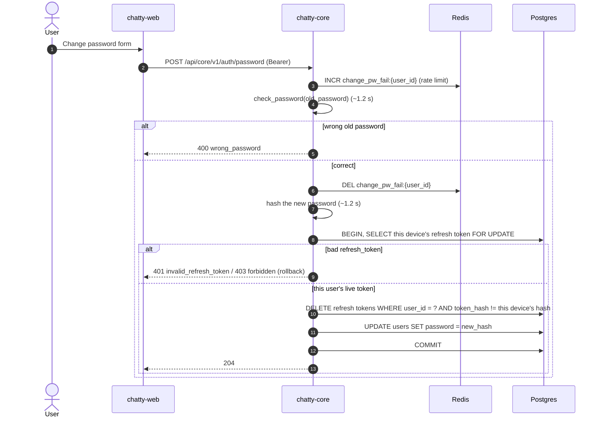

# Flow: change password

> **In one minute:** The user sends the old password, a new password, and this device's current refresh
> token. chatty-core verifies the old password, logs out every _other_ device, saves the new
> password hash, and keeps this device logged in.

## The picture

## Step by step

1. The user opens the change-password form and fills in the old password, a new password, and the current refresh token for this device is sent automatically by the web app.
2. The web app calls `POST /api/core/v1/auth/password`. The request must be authenticated (Bearer access token).
3. chatty-core validates the request body:
   - `new_password` must differ from `old_password`.
   - `new_password` must pass Django's password validators (min 10 chars, not common, not numeric-only, not similar to email or display name).
4. chatty-core increments `change_pw_fail:{user_id}` **before** the password check, so parallel guesses all count. If this request goes over the limit (5 per 15 minutes), `429 rate_limited` with `Retry-After`, and no hash is run.
5. chatty-core calls `check_password(old_password)` (~1.2 s for PBKDF2). If the old password is wrong, `400 wrong_password`; the counter keeps its +1.
6. If the old password is correct, chatty-core clears `change_pw_fail:{user_id}` and hashes the new password, outside the shared sync thread.
7. Then, in one transaction:
   - It loads and locks this device's `refresh_token` from the body **before changing anything**, so this device can't rotate it meanwhile. Unknown, expired or rotated → `401 invalid_refresh_token`. Belongs to another user → `403 forbidden`. Without this check, a bad token would match no row in the "keep this device" filter, and this device would be logged out too while the API still answered `204`.
   - It deletes all refresh tokens of this user **except** the one supplied in the request. The current device stays logged in; all other devices are logged out.
   - It saves the new password hash.
   - Returns `204`.

**Why one transaction?** The delete and the new password land together or not at all. If saving fails, other devices stay logged in and the password is unchanged, so the user can just try again.

## If a step fails

| Step | What happens |
|---|---|
| 2, missing or invalid access token | `401 unauthorized` |
| 3, new_password same as old | `400 validation_error` |
| 3, new password too weak | `400 validation_error` with field reason |
| 4, rate limit exceeded | `429 rate_limited` with `Retry-After` |
| 5, wrong old password | `400 wrong_password` (the counter keeps its +1) |
| 7, refresh token unknown, expired or rotated | `401 invalid_refresh_token` — password and sessions unchanged |
| 7, refresh token belongs to another user | `403 forbidden` — password and sessions unchanged |
| 7, DB error on delete or save | `500` — the transaction rolls back: password and sessions unchanged |

## ⚠️ Known gaps

- **No re-authentication on other devices.** Other devices lose their refresh token, but any access token already in memory on those devices remains valid for up to 15 minutes.

## Key code

| File | What is there |
|---|---|
| `users/views.py` | `ChangePasswordView` |
| `users/serializers.py` | `ChangePasswordRequest` (same-password check, password validators) |
| `users/services.py` | `UserService.change_password` (rate limit, password check, hash), `_revoke_and_set_password_sync` (the transaction) |
| `authn/services.py` | `AuthnService.check_own_refresh_token_sync` (live, owned by the caller, locked), `revoke_all_tokens_sync` (deletes all except keep_raw_token) |
| `authn/repositories.py` | `delete_all_for_user_sync` (bulk DELETE with `except_hash`) |
| `users/repositories.py` | `UserRepository.set_password_sync` |
| `shared/redis.py` | `rate_limit` (increment, then the check), `clear_rate_limit` |
