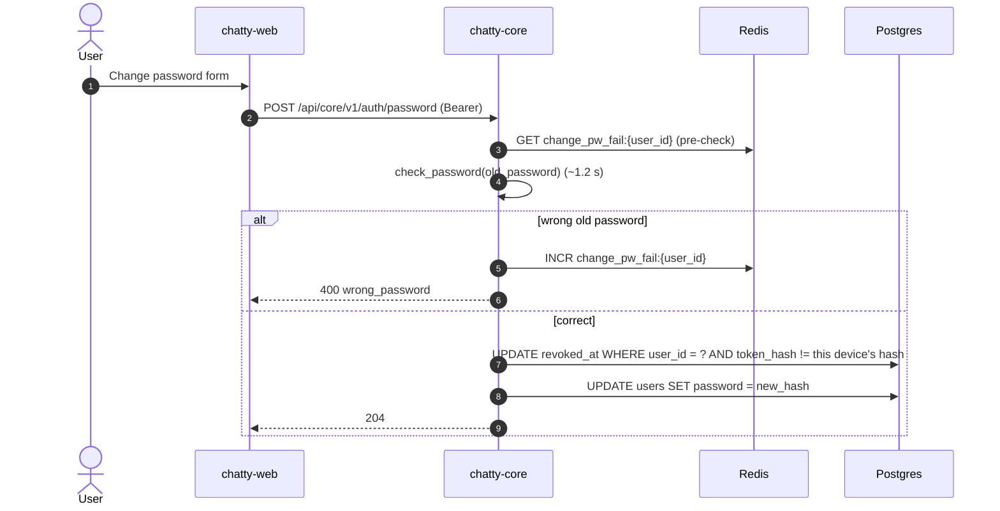

# Flow: change password

> **In one minute:** The user sends the old password, a new password, and this device's current refresh
> token. chatty-core verifies the old password, revokes every _other_ active session, saves the new
> password hash, and keeps this device logged in.

## The picture

## Step by step

1. The user opens the change-password form and fills in the old password, a new password, and the current refresh token for this device is sent automatically by the web app.
2. The web app calls `POST /api/core/v1/auth/password`. The request must be authenticated (Bearer access token).
3. chatty-core validates the request body:
   - `new_password` must differ from `old_password`.
   - `new_password` must pass Django's password validators (min 10 chars, not common, not numeric-only, not similar to email or display name).
4. chatty-core **pre-checks** the rate limit for `change_pw_fail:{user_id}`. If the user has already failed 5 times in the last 15 minutes, `429 rate_limited` with `Retry-After`. The pre-check reads the counter but does not increment it.
5. chatty-core calls `check_password(old_password)` (~1.2 s for PBKDF2). If the old password is wrong:
   - chatty-core increments `change_pw_fail:{user_id}` in Redis.
   - Returns `400 wrong_password`.
6. If the old password is correct:
   - chatty-core revokes all active refresh tokens for this user **except** the one supplied in the request. The current device stays logged in; all other devices are logged out.
   - chatty-core hashes the new password and saves it to the database.
   - Returns `204`.

**Why revoke first, then save?** If saving the new password fails, the worst outcome is that other devices were logged out but the password is unchanged — the user is still logged in on this device and can try again. The reverse order risks a window where the password is changed but other devices are still active.

## If a step fails

| Step | What happens |
|---|---|
| 2, missing or invalid access token | `401 unauthorized` |
| 3, new_password same as old | `400 validation_failed` |
| 3, new password too weak | `400 validation_failed` with field reason |
| 4, rate limit exceeded | `429 rate_limited` with `Retry-After` |
| 5, wrong old password | `400 wrong_password` (and the counter increments) |
| 6, DB error on revoke or save | `500` — revoke uses `aupdate` (bulk); if it fails nothing is saved |

## ⚠️ Known gaps

- **No re-authentication on other devices.** Other devices get their refresh token revoked, but any access token already in memory on those devices remains valid for up to 15 minutes.

## Key code

| File | What is there |
|---|---|
| `users/views.py` | `ChangePasswordView` |
| `users/serializers.py` | `ChangePasswordRequest` (same-password check, password validators) |
| `users/services.py` | `UserService.change_password` (rate limit, password check, revoke others, set password) |
| `authn/services.py` | `AuthnService.revoke_all_tokens` (revokes all except keep_raw_token) |
| `authn/repository.py` | `revoke_all_for_user` (bulk UPDATE with `except_hash`) |
| `users/repositories.py` | `UserRepository.set_password` (hashes off the thread pool, saves) |
| `shared/redis.py` | `is_rate_limited` (pre-check), `rate_limit` (increment on failure) |
