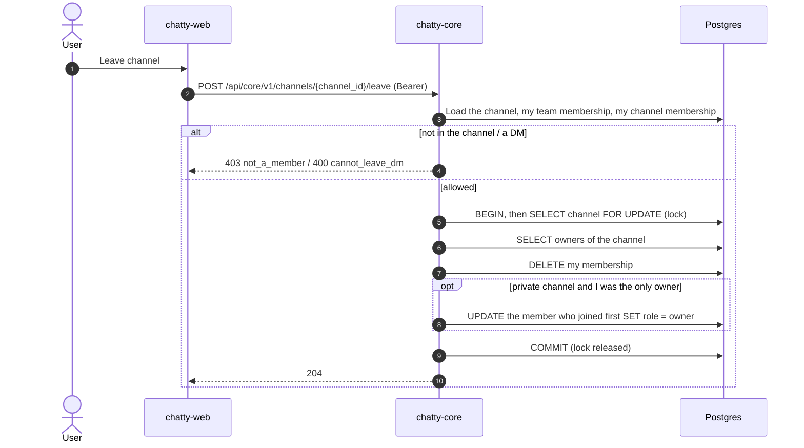

# Flow: join, leave and owner hand-off

> **In one minute:** Anyone in a team can join its public channels. Anyone can leave a channel except a
> DM. When the last owner of a private channel leaves or is removed, the member who joined first becomes
> the owner, so a private channel never ends up without someone who can manage it. chatty-core locks the
> channel row while it does this, so two people leaving at the same moment can't skip the hand-off.

## The picture

Leaving a private channel as its last owner:

## Step by step

**Join** (`POST /channels/{channel_id}/join`)

1. chatty-core checks that the channel exists, that I'm in its team, that it's public and that it isn't archived.
2. It adds me as a `member` with `notify_level: mentions`. If I'm already in the channel, it returns my existing membership with `200`, so joining twice is safe. Two joins at the same moment still create one row (`get_or_create`).

**Leave** (`POST /channels/{channel_id}/leave`)

1. chatty-core checks that I'm in the channel and that it isn't a DM. DMs can only be hidden.
2. In one transaction it locks the channel row, reads the owners, and deletes my membership.
3. If the channel is private and no active owner other than me is left, the active member who joined first (oldest `joined_at`) becomes the owner. Deactivated users don't count as owners and are never promoted. In a public channel nobody is promoted: team owners and admins can still manage it.
4. Returns `204`.

**Remove someone** (`DELETE /channels/{channel_id}/members/{user_id}`)

1. Removing myself returns `409 use_leave`.
2. Only the channel owner, a team owner or a team admin can remove someone.
3. The removal runs the same transaction as leave, so removing the last owner of a private channel also hands it off.

**Why lock the channel row, not the owner rows?** Suppose the only owner and the first-joined member leave
at the same moment. If only the owner rows were locked, the second leave would wait for the first, then
re-check only the rows it had already matched. It would miss that the first leave had just promoted
it to owner, delete itself, and leave the channel without an owner. Locking the channel row makes the
second leave wait and then read the owners again, so it sees the promotion and hands the channel on.

## If a step fails

| Step | What happens |
|---|---|
| The channel doesn't exist, or its team was deleted | `404 channel_not_found` |
| Join: I'm not in the team | `403 not_a_team_member` |
| Join: private channel or DM | `403 cannot_join_private` |
| Join: archived channel | `409 channel_archived` |
| Leave: I'm not in the channel | `403 not_a_member` |
| Leave: a DM | `400 cannot_leave_dm` |
| Remove: I'm not the channel owner, a team owner or an admin | `403 forbidden` |
| Remove: the person isn't in the channel | `404 member_not_found` |
| Remove: a DM | `400 not_allowed_for_dm` |
| DB error inside the leave or remove transaction | `500`, nothing changes: the delete and the promotion roll back together |

## ⚠️ Known gaps

- **chatty-chat isn't told yet.** `membership.changed` is not published until CHAT-172, so a removed user can keep receiving the channel's events until chatty-chat's cache expires.
- **The last person can leave a private channel.** It then has no members and no owner. Team owners and admins can still manage it.

## Key code

| File | What is there |
|---|---|
| `channels/views.py` | `JoinChannelView`, `LeaveChannelView`, `ChannelMemberDetailView` |
| `channels/services.py` | `ChannelService.join`, `leave`, `remove_member`, `_leave_sync` (the transaction) |
| `channels/repositories.py` | `ChannelMemberRepository.get_or_create`, `lock_owner_ids_sync` (the channel-row lock), `promote_first_joined_sync` |
| `channels/access.py` | Who can read, write and manage a channel |
| `tests/channels/test_leave_race.py` | The two-leaves-at-once race, run in two threads like two workers |
