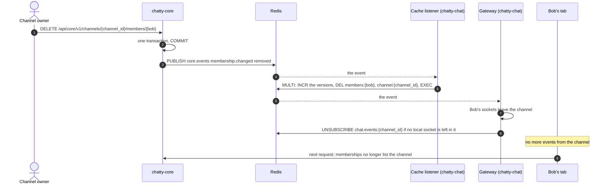

# Flow: a change in chatty-core reaches chatty-chat

> **In one minute:** When a membership, role, channel, team or user changes, chatty-core publishes one
> event on the Redis channel `core.events`, after its transaction commits. Every chatty-chat process gets
> it twice: the cache listener deletes the stale cache keys, and the gateway updates the sockets that are
> already open. So a user removed from a channel stops getting its events right away, and their next
> request sees the change.

## The picture

Removing Bob from a private channel while his tab is open:

## Step by step

1. chatty-core changes its database and, **after the commit**, publishes one event with the envelope
   `type`, `occurred_at`, `data` (D-06) on `core.events` (D-08). Code: `chatty-core/shared/events.py`.
2. Every chatty-chat process has two subscribers on `core.events`, so it gets the event twice.
3. **The cache listener** (`listen_core_events`) marks the stale keys: it increments each key's version
   and deletes the key, in one transaction.

   | Event | Keys |
   |---|---|
   | `membership.changed` | `members:{user_id}`, `channel:{channel_id}` |
   | `team.member.changed`, `user.deactivated` | `members:{user_id}` |
   | `channel.updated` | `channel:{channel_id}` |
   | `team.deleted` | `version:all`, then every `channel:*` key (the event only has `team_id`) |

   The version stops a request that read chatty-core just before the change from caching its old answer
   afterwards ([live events](../realtime.md#the-cache-and-its-versions)).
4. **The gateway** (`Gateway.handle_core_event`) updates open sockets on this process:

   | Event | Sockets |
   |---|---|
   | `membership.changed` `added` / `removed` | The user's sockets join / leave the channel |
   | `channel.updated` | The channel's sockets get `{"type": "channel.updated", …}` |
   | `user.deactivated` | The user's sockets are closed with `4003` |
   | `team.member.changed` `left` / `removed` | A watch on that team's channel ends |
   | `team.deleted` | Nothing |

5. Unknown or malformed events are logged and ignored, so a new event type from chatty-core can't stop
   either listener.

**Events sent while a listener isn't subscribed are lost**, because pub/sub stores nothing. So:
- the cache listener bumps `version:all` and deletes every `members:*` and `channel:*` key each time it
  subscribes, at start and after Redis comes back;
- the gateway closes every local socket with `1001 gateway_restart` when it reconnects, and the browsers
  reconnect with fresh memberships and `POST /sync`.

## If a step fails

| Step | What happens |
|---|---|
| Redis down when chatty-core publishes | chatty-core logs it; its change is saved. chatty-chat's cache entries expire within 5 minutes, and both listeners clear up when Redis is back |
| Redis down for chatty-chat | Both listeners retry: 1 s, doubling up to 30 s. Then the cache is cleared and the sockets are closed with `1001` |
| A malformed event | Logged and skipped |
| A request read chatty-core just before the change | Its answer isn't cached: the version changed ([CHAT-266](https://assist-team-m66z4ph1.atlassian.net/browse/CHAT-266)) |

## ⚠️ Known gaps

- **Deleting a team doesn't stop live events right away.** Only `team.deleted` is sent, with no
  `membership.changed removed` per channel, and the gateway does nothing for it. The team's channels are
  read-only, so no new events arrive there.
- **Watch uses the memberships loaded at connect** ([CHAT-231](https://assist-team-m66z4ph1.atlassian.net/browse/CHAT-231)).

## Key code

| File | What is there |
|---|---|
| `chatty-core/shared/events.py` | `publish`: one event on `core.events` after the commit |
| `chatty-chat/app/clients/core_events.py` | `handle_event`, `mark_stale`, `mark_all_stale`, `clear_cache`, the listener loop |
| `chatty-chat/app/services/gateway.py` | `handle_core_event`, `_membership_changed` |
| `chatty-chat/app/schemas/core_events.py` | `CoreEventType`, the event data schemas |
| `chatty-chat/tests/integration/test_gateway_real.py` | From `core.events` to a connected socket |
