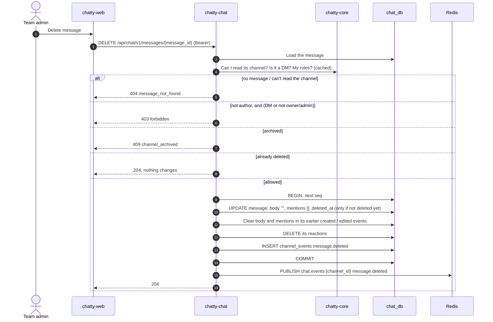

# Flow: edit and delete a message

> **In one minute:** Only the author can edit a message. The author can always delete it; in public and
> private channels the channel owner and team owners and admins can delete it too, in DMs only the author
> (D-05). Delete is soft: the message keeps its place and `seq` but loses its text and its reactions, and
> its text is also cleared in the earlier events. Both take the channel's next `seq`, write an event row and
> publish it after the commit, like sending.

## The picture

Deleting someone else's message as a team admin:

## Step by step

**Edit** (`PUT /messages/{message_id}`)

1. `body` is 1 to 4000 characters.
2. The message must exist and its channel must be readable, else `404 message_not_found` (so nobody
   learns it exists).
3. Someone else's message: `403 not_author`. Deleted: `409 message_deleted`.
4. The user must still be able to write: archived or team deleted is `409 channel_archived`; an author
   who left the channel gets `403 not_a_member`.
5. Mentions are worked out again from the new body.
6. One transaction: the next `seq`, then `UPDATE … WHERE deleted_at IS NULL` sets the body, mentions and
   `edited_at`. If the message was deleted meanwhile, the update finds nothing and the answer is `409`;
   the rollback gives the `seq` back. Then the `message.edited` event row.
7. After the commit `message.edited` is published, and the answer is `200` with the message object. The
   message keeps its own `seq`; the new `seq` belongs to the event.

**Delete** (`DELETE /messages/{message_id}`)

1. The message must exist and its channel be readable, else `404 message_not_found`.
2. Allowed: the author; or, outside DMs, the channel owner or a team owner or admin. Otherwise
   `403 forbidden`.
3. Archived or team deleted: `409 channel_archived`. Already deleted: `204` and no event.
4. One transaction: the next `seq`, then `UPDATE … WHERE deleted_at IS NULL` clears the body and mentions
   and sets `deleted_at`. If another delete got there first, nothing is updated, the transaction rolls
   back (no `seq` used) and the answer is still `204`. Then, in the same transaction:
   - `body` and `mentions` are cleared in the message's earlier `message.created` (the one with the
     message's own `seq`) and `message.edited` events, so `GET …/events` and `POST /sync` can't show the
     deleted text (CHAT-270). The rows keep their `seq` and type.
   - The message's reactions are deleted, without `reaction.removed` events: `message.deleted` tells the
     web app to drop them (CHAT-203).
   - The `message.deleted` event row.
5. After the commit `message.deleted` is published; `204`.

**Why the conditional `UPDATE`?** It locks the row and checks "not deleted yet" in one statement, so an
edit and a delete at the same moment can't both win. Both take the counter row first and the message row
second, the same order as sending, so they can't deadlock each other.

Neither edit nor delete moves the read position: editing an old message doesn't mean you read everything
after it.

## If a step fails

| Step | What happens |
|---|---|
| Body empty or over 4000 characters (edit) | `400 validation_error` |
| No message, or a channel I can't read | `404 message_not_found` |
| Edit someone else's message | `403 not_author` |
| Edit after I left the channel | `403 not_a_member` |
| Edit a deleted message | `409 message_deleted` |
| Delete without the right (D-05) | `403 forbidden` |
| Archived, or team deleted | `409 channel_archived` |
| Deleted at the same moment by someone else | Edit: `409 message_deleted`. Delete: `204`, one event only |

## ⚠️ Known gaps

- **A team admin who isn't in a private channel can't delete there.** They can't read the channel, so they
  get `404`, although D-05 lets admins delete any message. To confirm with the PO.
- **Files aren't detached on delete yet** ([CHAT-212](https://assist-team-m66z4ph1.atlassian.net/browse/CHAT-212)),
  and there are no pins to remove yet ([CHAT-204](https://assist-team-m66z4ph1.atlassian.net/browse/CHAT-204)).
- **Deleted text that was already sent stays sent.** Clearing the earlier events only covers what is
  stored; a tab that got `message.created` over the WebSocket before the delete still has the text until
  it applies `message.deleted`.

## Key code

| File | What is there |
|---|---|
| `chatty-chat/app/services/message_service.py` | `MessageService.edit`, `delete`, `get_readable_message` |
| `chatty-chat/app/services/access_service.py` | `get_channel_for_delete`, `_can_delete_others` (D-05) |
| `chatty-chat/app/repositories/messages.py` | `update_message_body`, `soft_delete_message`: the conditional updates |
| `chatty-chat/app/repositories/channel_events.py` | `clear_message_text`: empties the deleted text in earlier events |
| `chatty-chat/app/repositories/reactions.py` | `delete_message_reactions` |
| `chatty-chat/tests/integration/test_delete_message_real.py` | Two deletes at once write one event; a delete clears the text in earlier events |
