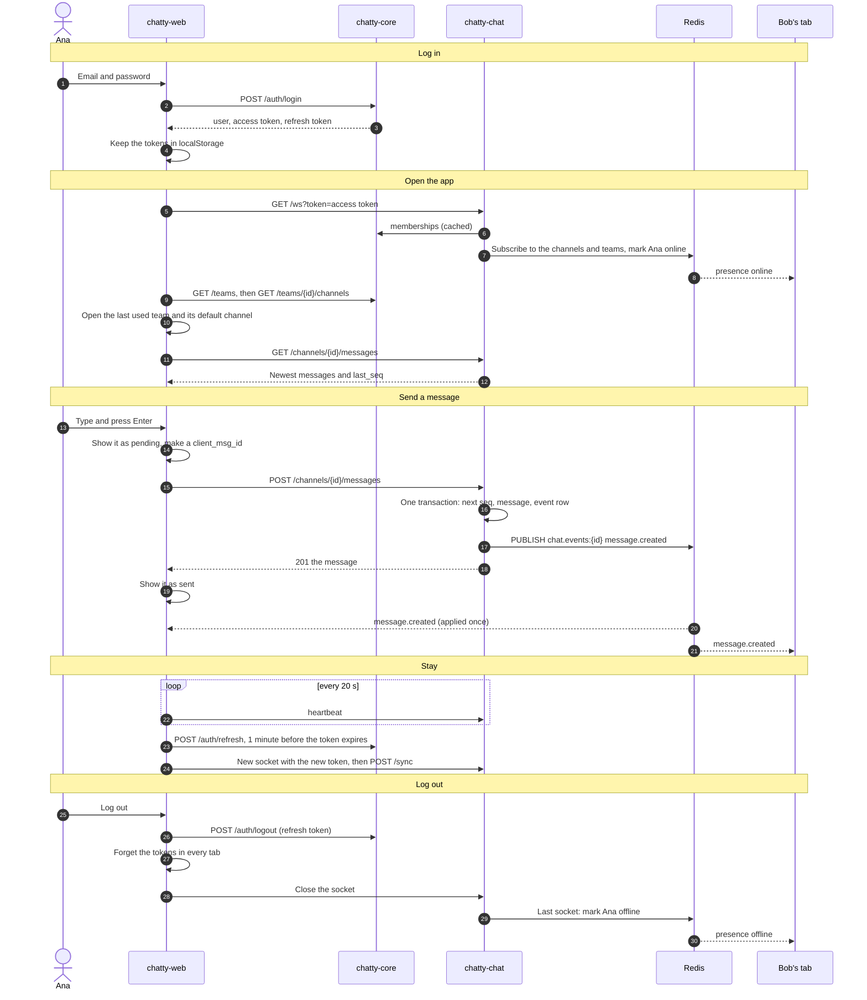

# Flow: from login to logout

> **In one minute:** This page follows one person through a whole visit. They log in with chatty-core and get
> two tokens. The app shell opens a WebSocket to chatty-chat and loads their teams and channels. Opening a
> channel loads its history. Sending a message shows it at once, saves it with REST and reaches the other tabs
> as an event. While they stay, a heartbeat keeps the socket alive and the tokens are renewed. Logging out
> revokes the refresh token, clears the tokens in every tab and closes the socket. Each step has its own flow
> page with the details.

## The picture

## Step by step

**1. Open the app**

1. The browser loads the app from the Vite dev server or Nginx. Everything after that goes to the same origin,
   and the proxy forwards it ([chatty-web](../../services/web/index.md#who-talks-to-it)).
2. With no refresh token in `localStorage`, the user is anonymous and `RequireAuth` sends them to `/login`. It
   remembers the page they wanted.
3. With one, the app is `loading`: it renews the access token if needed and calls `GET /me`. If that works the
   user is logged in. A rejected token ends the session; a server that can't be reached shows "Chatty can't be
   reached" and keeps the tokens.

**2. Log in** ([register and login](register-and-login.md))

4. `POST /api/core/v1/auth/login` returns the user, an access token (a JWT, 15 minutes) and a refresh token (30
   days). A new user calls `POST /auth/register` first, and the app then logs them in.
5. `startSession` stores both tokens in `localStorage`, tells the other tabs (`BroadcastChannel`) and sets a
   timer to refresh a minute before the token expires.
6. `GuestOnly` sees a logged-in user and goes to the page they wanted, or `/`.

**3. Connect** ([connect the WebSocket](websocket.md))

7. `RequireAuth` lets the app shell mount, and `WsProvider` opens one socket for this tab:
   `GET /api/chat/v1/ws?token=<access token>`.
8. chatty-chat accepts, checks the token and loads the memberships, from Redis or chatty-core. Then the gateway
   adds the socket to the user's channels and teams, and subscribes in Redis where this process needs it.
9. If this is the user's first socket, they become [online](see-who-is-online.md). The web app doesn't show it yet.
10. From now on the tab sends a heartbeat every 20 s, and also when it is shown or hidden.

**4. Open a channel** ([open a channel, reconnect and sync](reconnect-and-sync.md))

11. `TeamsProvider` calls `GET /teams`, and `/` opens the last used team, or the first one. Someone with no team
    gets a welcome page to create or join one.
12. `ChannelsProvider` calls `GET /teams/{team_id}/channels` for the sidebar, and the team opens its default
    channel.
13. The message list calls `GET /channels/{channel_id}/messages`, with up to 50 messages, the channel's
    `last_seq`, reactions and `pinned`. Events that arrive meanwhile wait, and are applied after it.
14. Scrolling up loads older messages with `before_seq`.

**5. Send a message** ([send a message](send-message.md))

15. The composer turns each picked `@name` into `<@user_id>`, and Enter sends. Empty text and text over 4000
    characters can't be sent.
16. The store adds the message right away as `pending`, with a new `client_msg_id`, and the composer clears.
17. `POST /channels/{channel_id}/messages` checks access, then saves the message and an event row in one
    transaction with the channel's next `seq`, and moves the sender's read position.
18. After the commit, chatty-chat publishes `message.created` and answers `201`. The store replaces the pending
    copy with the real message.

**6. Everyone gets it** ([live events](../realtime.md))

19. Each gateway with a socket in the channel gets the event from Redis and forwards it to its sockets.
20. Each tab handles it by `seq`:

    | The event's `seq` | What the tab does |
    |---|---|
    | Already seen | Drops it |
    | The next one | Applies it |
    | Higher | Holds it, gets the missing events with `GET …/events`, then applies it |

21. The sender's own tab gets the message twice, as the `201` and as the event, and keeps one, by `id`. The event
    can also arrive first: then the `201` removes the pending copy.
22. An event for a channel this tab hasn't opened is ignored. Opening that channel loads it from history.

**7. Stay connected** ([refresh and logout](refresh-and-logout.md), [reconnect and sync](reconnect-and-sync.md))

23. A minute before the access token expires, the tab refreshes it inside a Web Lock, so only one tab rotates the
    refresh token. The others get the new token.
24. At about the same moment `WsProvider` closes the socket and opens a new one, so the server never has to
    close it with `4001`.
25. After every open, the tab calls `POST /sync` with the last `seq` of each loaded channel. Live messages wait
    until it answers, so everything stays in order.
26. If the socket drops, it reconnects with backoff, and sooner when the browser says it is online again.

**8. Log out** ([refresh and logout](refresh-and-logout.md))

27. In the user menu, Log out calls `POST /auth/logout` with this device's refresh token, inside the Web Lock.
28. `endSession` clears the tokens, even if that call failed, and tells the other tabs, which log out too.
29. `RequireAuth` sends the tab to `/login`. The app shell unmounts: the socket closes, the timers stop, and the
    messages in memory are gone.
30. chatty-chat's `disconnect` removes the socket. If it was the user's last one they go
    [offline](see-who-is-online.md).
31. The last used team stays in `localStorage`, and the next login checks it against that user's teams.

## If a step fails

| Step | What happens |
|---|---|
| Wrong password | `401 invalid_credentials` on the form, with rate limits after 5 tries |
| chatty-core is down on load | "Chatty can't be reached" with Try again; the tokens are kept |
| The socket can't connect | Backoff and retry. REST calls still work |
| `1011` at connect, chatty-core unreachable | Reconnect with backoff, then `POST /sync` |
| `4001` token expired | Refresh, reconnect right away, then `POST /sync` |
| `4002` no heartbeat | Reconnect right away, then `POST /sync` |
| `4003` user deactivated | The tab logs out |
| The history doesn't load | The list shows the failure and lets the user try again |
| Sending fails | The message stays as `failed` with the reason. Retry reuses the `client_msg_id`, so it can't be saved twice |
| The channel was archived while typing | `409 channel_archived`, and the composer turns read-only |
| Too many events were missed | `gap_too_large`: the channel reloads from history |
| The refresh token is rejected | The session ends in every tab, and they go to `/login` |
| `POST /auth/logout` fails | The tokens are forgotten anyway; the refresh token stays valid until it expires |

## ⚠️ Known gaps

- **An access token still works after logout**, for up to 15 minutes (D-10).
- **Each token renewal closes the socket first**, so a user with one tab has a moment with no socket about every
  14 minutes. It can show as offline and online to the others.
- **A new channel or DM doesn't show in the sidebar** until the team changes or the page reloads.
- **Channels that aren't open only update their badge.** Their messages load when the channel is opened.

More: [known limitations](../known-limitations.md#web).

## Key code

| File | What is there |
|---|---|
| `chatty-web/src/features/auth/hooks/use-auth-state.ts` | Restore, login, register, logout |
| `chatty-web/src/lib/session.ts` | `startSession`, `endSession`, `refreshSession` |
| `chatty-web/src/app/layouts/app-layout.tsx` | The providers that start after login |
| `chatty-web/src/features/ws/ws-provider.tsx` | Connect, reconnect, `POST /sync` |
| `chatty-web/src/features/messages/messages-provider.tsx` | `loadChannel`, `send`, `retry` |
| `chatty-web/src/features/messages/store/event-sequencer.ts` | What a tab does with an event |
| `chatty-core/authn/` | Login, refresh, logout: see [register and login](register-and-login.md) |
| `chatty-chat/app/api/routers/ws.py` | The socket on the server |
| `chatty-chat/app/services/message_service.py` | `MessageService.send` |
| `chatty-chat/app/services/gateway.py` | Forwarding events to sockets |
