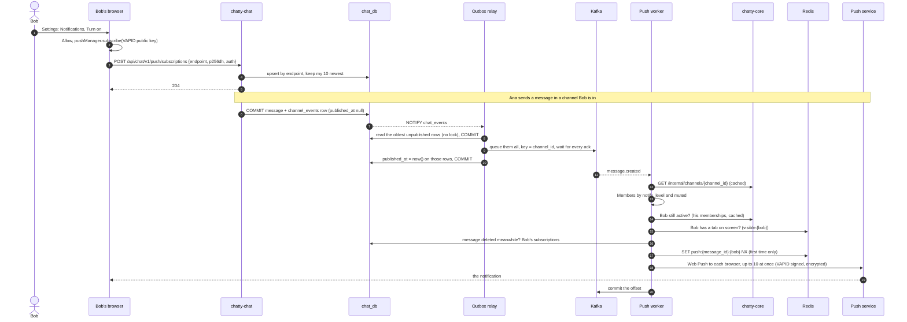

# Flow: get a push notification

> **In one minute:** A browser that allowed notifications gives the web app a push subscription, and the web
> app saves it in chatty-chat. Every saved channel event is also a row in `channel_events`; the outbox relay
> sends those rows to Kafka in order. The push worker reads `message.created` from Kafka, picks the
> channel members who want a notification and have no Chatty tab on screen, and sends each of their
> browsers a Web Push. The browser shows it even when Chatty is closed.

## The picture

## Step by step

**1. Turn it on** (the web app, Settings)

1. `NotificationsSection` asks the browser for permission (from a click) and registers the service worker
   `/sw.js?user={user_id}`.
2. `pushManager.subscribe` with the VAPID public key from `VITE_VAPID_PUBLIC_KEY` gives an `endpoint`,
   `p256dh` and `auth`.
3. `POST /push/subscriptions` saves them (D-13). The endpoint must be `https` on a known push service
   (Google, Mozilla, Apple, Windows), so the worker can't be pointed at an internal address. A known
   endpoint gets the new keys and the current user, so a shared computer only gets pushes for whoever is
   logged in. Each user keeps their 10 newest.
4. Turning it off, and logging out, unsubscribe the browser and call `DELETE /push/subscriptions`, which
   only deletes the caller's own row.
5. A session that ends without the logout button (an expired or revoked refresh token, a deactivated user,
   a logout in another tab) unsubscribes the browser too, on the web app's `logged-out` event
   (`forgetPushSubscription`). There is no token left for the `DELETE`, so the push service answers `410`
   to the next push and the worker deletes the row. The next person who logs in on that browser doesn't
   inherit the subscription ([CHAT-282](https://assist-team-m66z4ph1.atlassian.net/browse/CHAT-282)).
6. When chatty-core deactivates a user, chatty-chat's `core.events` listener deletes all their
   subscriptions on `user.deactivated` (CHAT-282). If the database is down then, it is logged and skipped;
   the worker still sends nothing to an inactive user (below).

**2. The outbox relay** (`python -m app.jobs.relay`, its own container)

1. Every channel event is written to `channel_events` in the same transaction as the change, with
   `published_at` null. A trigger sends `NOTIFY chat_events` on commit, which wakes the relay; it also
   polls every 0.2 s, in case a `NOTIFY` was lost.
2. The relay reads up to 100 unpublished rows, oldest `id` first, without a row lock, and ends that
   read's transaction. With no transaction open, it queues them all on the Kafka topic `chat.events` with
   `key = channel_id`, in that order, and waits until Kafka acknowledges every one. Then a short
   transaction of its own sets `published_at` on those rows. One channel's events land in one partition,
   in order: the idempotent producer keeps the order per partition.
3. If any record fails, the error is raised after every queued record has been awaited, and nothing is
   marked: the whole batch goes again a second later, so Kafka may get duplicates.
4. Only one relay runs at a time: it holds a Postgres advisory lock, and a second one waits for it. Two
   relays could reorder a channel's events.

**Why no row lock?** Until [CHAT-285](https://assist-team-m66z4ph1.atlassian.net/browse/CHAT-285) the relay
locked its rows `FOR UPDATE` and sent them inside that transaction. Deleting a message rewrites its
`message.created` row while holding the channel's counter lock, so while Kafka was slow or down a delete
waited on the relay, and every send, reaction and pin in that channel waited behind the delete. The
advisory lock already makes sure only one relay reads the rows. The cost: a message deleted while its
batch is on the way reaches Kafka with its text. The worker skips it (below), and Kafka drops the record
after 7 days.

**3. The push worker** (`python -m app.jobs.push_worker`, its own container)

1. It reads `chat.events` in the consumer group `push-worker`, one event at a time, and commits the
   offset after each. Only `message.created` counts, and only if it is less than 10 minutes old.
2. The channel comes from the same cache as the API, or chatty-core. An archived channel or a deleted
   team gets nothing.
3. Who gets it: every member but the author who isn't muted, with `notify_level` `all`, or `mentions` and
   mentioned.
4. Minus anyone deactivated: each recipient's memberships (from the cache, or chatty-core) must say
   `is_active`, in case `user.deactivated` was missed (CHAT-282).
5. Minus anyone with a tab on screen in the last 45 s: the heartbeat's `visible` keeps
   `visible:{user_id}` in Redis. A Redis error counts as not looking: an extra notification is better
   than a missed one.
6. If the message was deleted meanwhile, or isn't there, nothing is sent: a message deleted while it waited
   in Kafka never reaches a lock screen
   ([CHAT-283](https://assist-team-m66z4ph1.atlassian.net/browse/CHAT-283)). One deleted after its push
   went out can't be taken back.
7. `SET push:{message_id}:{user_id} NX` (1 day) makes sure a user gets each message once, even if Kafka
   delivers it again after a crash.
8. Each browser of the user gets `{type, team_id, channel_id, message_id, seq, mentioned, preview}`,
   with the first 100 characters of the body, signed with the VAPID private key and encrypted for that
   browser. The sends run in parallel, at most 10 at once
   ([CHAT-287](https://assist-team-m66z4ph1.atlassian.net/browse/CHAT-287)). A push service that answers
   `404` or `410` means the browser unsubscribed: the row is deleted.

**4. The browser.** `sw.js` shows "New message" or "You were mentioned" with the preview, mentions shown
as `@you` or `@someone` and a GIF's link as "Sent a GIF", one notification per channel. A click opens the channel in a Chatty tab, or a
new one.

## If a step fails

| Step | What happens |
|---|---|
| Save: not a known push service, or keys of the wrong length | `400 validation_error` |
| Kafka down | The relay's batch fails without marking anything and is tried again every second; rows stay unpublished and are sent when it is back. No transaction or row lock is held meanwhile, so the API and live events over Redis keep working |
| One record of a batch refused | The whole batch is sent again; Kafka may get duplicates, which the dedupe key absorbs |
| The relay crashes after sending, before marking | Those events are sent again. Kafka delivers at least once; the dedupe key stops a second push |
| The message was deleted before the worker got to it | Nothing is sent |
| A recipient was deactivated | Nothing is sent to them; their subscriptions were deleted on `user.deactivated` |
| chatty-core, the database or Redis down in the worker | It retries the same event every second, so nothing is lost. After 10 minutes the event is too old and is skipped |
| One browser's push service fails | Logged, the others still get theirs; it isn't retried |
| `VAPID_PRIVATE_KEY` not set | The worker doesn't start. The web app hides the button if `VITE_VAPID_PUBLIC_KEY` is empty |

## ⚠️ Known gaps

- **One event at a time.** Each event's sends run in parallel, but the worker takes the next event only
  when they are done. Up to 6 workers (one per partition) can share the work if it lags.
- **One lookup per recipient, one after another.** Each recipient's memberships (for `is_active`) and
  `visible` key are read in turn; a cold cache means one chatty-core call per recipient.
- **A worker crash between the dedupe key and the send** loses that user's push for that message.
- **A push that already went out can't be taken back** when its message is deleted.
- **The relay doesn't notice it lost its advisory lock** if its control connection drops, so a second
  relay could start next to it. Without row locks, both would send the same rows: duplicates in Kafka,
  which the dedupe key absorbs.

## Key code

| File | What is there |
|---|---|
| `chatty-chat/app/api/routers/push.py` | `POST` and `DELETE /push/subscriptions` |
| `chatty-chat/app/schemas/push.py` | The endpoint and key checks, the push payload |
| `chatty-chat/app/services/push_subscription_service.py` | Save (upsert, 10 newest), delete |
| `chatty-chat/app/jobs/relay.py` | The relay loop: advisory lock, `LISTEN`, poll |
| `chatty-chat/app/services/outbox_relay.py` | `publish_batch`: read, send in parallel, mark |
| `chatty-chat/app/repositories/channel_events.py` | `list_unpublished`, `mark_published` |
| `chatty-chat/app/jobs/push_worker.py` | The consumer loop and its retries |
| `chatty-chat/app/services/push_service.py` | `push_recipients`, `PushService.handle`: the active and deleted checks, `MAX_PARALLEL_SENDS` |
| `chatty-chat/app/clients/core_events.py` | Deletes a deactivated user's subscriptions on `user.deactivated` |
| `chatty-chat/app/clients/web_push.py` | `WebPushClient`, `PushDedupe` |
| `chatty-chat/app/clients/kafka.py` | The producer and consumer, keyed by `channel_id` |
| `chatty-web/src/features/push/` | Turn on and off, the settings section, `forgetPushSubscription` after a session ends |
| `chatty-web/public/sw.js` | The service worker: show the notification, open the channel |
