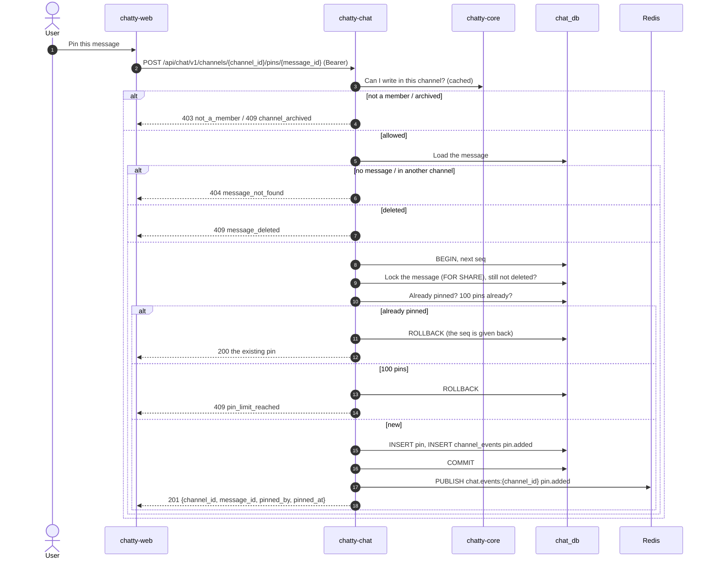

# Flow: pin a message

> **In one minute:** Anyone who can write in a channel can pin one of its messages, and anyone who can
> write can unpin it, not only who pinned it. A channel has at most 100 pins. A real change takes the
> channel's next `seq`, writes `pin.added` or `pin.removed` and publishes it after the commit, like
> sending. Pinning a message that is already pinned, or unpinning one that isn't, changes nothing: no
> `seq`, no event. Anyone who can read the channel sees its pin list.

## The picture

Pinning a message:

## Step by step

**Pin** (`POST /channels/{channel_id}/pins/{message_id}`)

1. I must be able to write in the channel: not a member is `403 not_a_member`, and an archived channel
   or a deleted team is `409 channel_archived`.
2. The message must exist and be in this channel, else `404 message_not_found`. Deleted:
   `409 message_deleted`.
3. One transaction: the next `seq`, then the message row is locked `FOR SHARE` and checked again. A
   delete that committed meanwhile gives `409`, and a delete that comes later waits for this transaction.
4. Already pinned: the transaction rolls back (the `seq` is given back) and the answer is `200` with the
   existing pin, who pinned it and when.
5. The channel's pins are counted. At 100: `409 pin_limit_reached`, and the transaction rolls back.
6. Otherwise the `pins` row and the `pin.added` row `{message_id, pinned_by, pinned_at}`. After the
   commit `pin.added` is published; `201` with the pin.

**Unpin** (`DELETE /channels/{channel_id}/pins/{message_id}`)

1. The same write and message checks, but no deleted check: deleting a message already removed its pin.
2. One transaction: the next `seq`, then `DELETE … RETURNING` the pin. Nothing removed rolls back (no
   `seq` used) and the answer is still `204`. Otherwise the `pin.removed` row `{message_id, unpinned_by}`.
3. After the commit `pin.removed` is published; `204`.

**The pin list** (`GET /channels/{channel_id}/pins`)

Anyone who can read the channel. Newest pin first, not paginated (at most 100). Each entry has
`pinned_by`, `pinned_at` and the full message object, with my reactions and `pinned: true`. History also
sets `pinned` on every message, loaded in one query for the whole page.

**Why the count is safe.** The count runs after the channel's counter row is locked, so two pins in the
same channel wait for each other. At 99 pins, two pins at once give one `201` and one `409`; they can't
both see 99.

**Deleting a pinned message** removes its pin in the delete's transaction, without `pin.removed`:
`message.deleted` tells the web app to drop it from the pin list. See
[edit and delete](edit-and-delete-message.md).

Pinning doesn't move the read position.

## If a step fails

| Step | What happens |
|---|---|
| Not in the channel | `403 not_a_member` |
| Archived, or team deleted | `409 channel_archived` |
| No message, or a message in another channel | `404 message_not_found` |
| Pin a deleted message | `409 message_deleted` |
| The channel has 100 pins | `409 pin_limit_reached` |
| Pin one that is already pinned | `200` with the existing pin, no event |
| Unpin one that isn't pinned | `204`, no event |
| Two pins at 99 at once | One `201`, one `409 pin_limit_reached` |
| The message is deleted at the same moment | The pin gets `409`, or lands first and is removed by the delete |

## ⚠️ Known gaps

- **No order other than newest first.** Pins can't be reordered; the contract has no order field.
- **The list isn't paginated.** That is fine at 100 pins, but the whole list with full messages comes in
  one answer.

## Key code

| File | What is there |
|---|---|
| `chatty-chat/app/api/routers/pins.py` | Pin, unpin, list pins |
| `chatty-chat/app/services/pin_service.py` | `PinService.pin`, `unpin`, `list_pins`, `MAX_PINS` |
| `chatty-chat/app/repositories/pins.py` | `get_pin`, `count_pins`, `add_pin`, `remove_pin`, `pinned_message_ids`, `list_pins`, `delete_message_pin` |
| `chatty-chat/app/repositories/messages.py` | `lock_undeleted_message`: the `FOR SHARE` lock |
| `chatty-chat/tests/integration/test_pins_real.py` | Pin twice, two pins at 99, a pin racing a delete, delete removes the pin |
