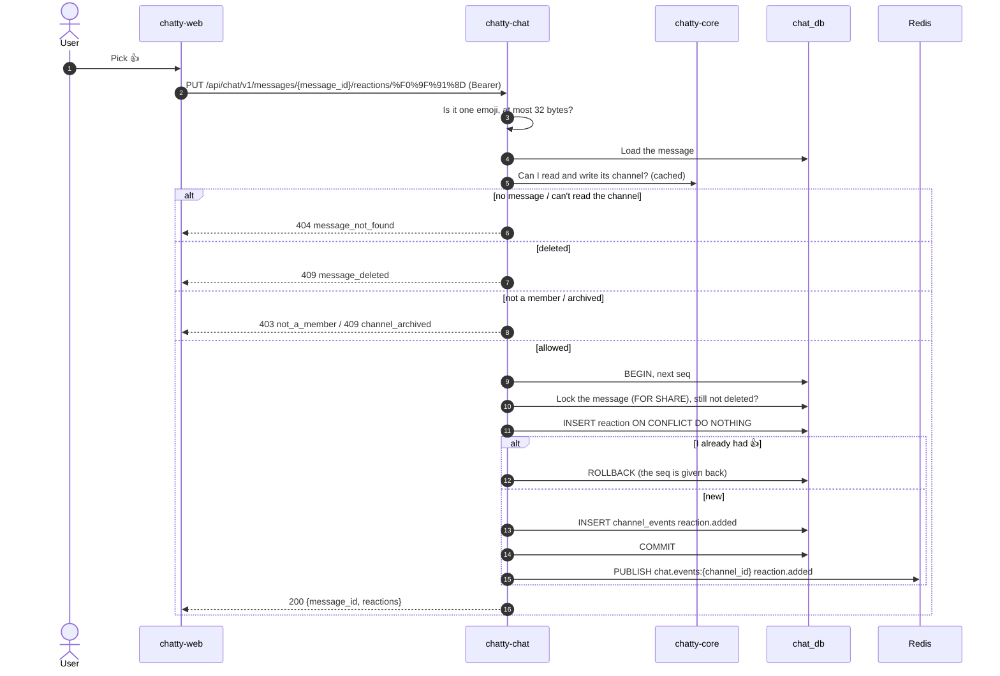

# Flow: react to a message

> **In one minute:** Anyone who can write in a channel can add an emoji to a message and remove their own
> (D-05). A user can add several emoji to one message, each once. A real change takes the channel's next
> `seq`, writes `reaction.added` or `reaction.removed` and publishes it after the commit, like sending.
> Adding an emoji I already have, or removing one I don't have, changes nothing: `200`, no `seq`, no event.
> Both answers carry the message's reactions with a `count` and `me` per emoji.

## The picture

Adding 👍:



## Step by step

**Add** (`PUT /messages/{message_id}/reactions/{emoji}`)

1. `emoji` is in the path, URL-encoded (`%F0%9F%91%8D` is 👍). It must be exactly one emoji, skin tones,
   flags and joined ones (👨‍👩‍👧) included, and at most 32 bytes; otherwise `400 validation_error` with
   `fields: {"emoji": "invalid"}`. The check uses the `emoji` package.
2. The message must exist and its channel must be readable, else `404 message_not_found`.
3. Deleted: `409 message_deleted`. Not a member: `403 not_a_member`. Archived or team deleted:
   `409 channel_archived`.
4. One transaction: the next `seq`, then the message row is locked `FOR SHARE` and checked again. A
   delete that committed meanwhile gives `409`, and a delete that comes later waits for this transaction.
   Then `INSERT … ON CONFLICT DO NOTHING RETURNING`: no row back means I already had this emoji, so the
   transaction rolls back and the `seq` is given back. Otherwise the `reaction.added` row
   `{message_id, user_id, emoji}`.
5. After the commit `reaction.added` is published. The answer is `200` with the message's reactions.

**Remove** (`DELETE /messages/{message_id}/reactions/{emoji}`)

1. The same emoji, read and write checks, but no deleted check: a deleted message has no reactions left,
   so there is nothing to remove and the answer is `200`.
2. One transaction: the next `seq`, then `DELETE … RETURNING` my reaction. Nothing removed rolls back
   (no `seq` used). Otherwise the `reaction.removed` row.
3. After the commit `reaction.removed` is published; `200` with the reactions that are left.

**The answer** (both):

```json
{ "message_id": "9f3a…", "reactions": [{ "emoji": "👍", "count": 2, "me": true }] }
```

One entry per emoji, in the order the emoji were first used. `me` is true when the caller reacted with it.
History returns the same list on every message, loaded in one query for the whole page; a deleted message
always has `[]`.

**Why the counter first?** Send, edit, delete and both reaction calls all take the channel's counter row
first, then the message. So a reaction and a delete on the same channel run one after the other and can't
deadlock: the reaction either lands before the delete (and the delete removes it) or sees the delete and
gets `409`.

Reacting doesn't move the read position.

**In the web app**, the tab that reacted gets its change twice: in the REST answer and as the event. The
event says "add 1" or "remove 1", so the counts come from the events only; the REST answer tells that the
request worked ([CHAT-206](https://assist-team-m66z4ph1.atlassian.net/browse/CHAT-206)).

## If a step fails

| Step | What happens |
|---|---|
| Not one emoji, or over 32 bytes | `400 validation_error`, `fields: {"emoji": "invalid"}` |
| No message, or a channel I can't read | `404 message_not_found` |
| Add to a deleted message | `409 message_deleted` |
| Not in the channel | `403 not_a_member` |
| Archived, or team deleted | `409 channel_archived` |
| Add an emoji I already have, or remove one I don't have | `200`, nothing changes, no event |
| The same add twice at once | One reaction, one event; the other request rolls back |
| The message is deleted at the same moment | The add gets `409`, or lands first and is removed by the delete |

## ⚠️ Known gaps

- **No limit on reactions** per message or per user; the contract sets none.
- **No list of who reacted.** `reactions` only has `count` and `me`, so the web app can't show names on
  hover yet (see [CHAT-206](https://assist-team-m66z4ph1.atlassian.net/browse/CHAT-206)).
- **`❤` and `❤️` are two reactions.** Both are valid emoji (the second has an invisible variation
  character), and they aren't normalised.

## Key code

| File | What is there |
|---|---|
| `chatty-chat/app/api/routers/reactions.py` | `PUT` and `DELETE …/reactions/{emoji}` |
| `chatty-chat/app/schemas/messages.py` | `check_emoji` and the `Emoji` path type, `ReactionsResponse` |
| `chatty-chat/app/services/reaction_service.py` | `ReactionService.add`, `remove` |
| `chatty-chat/app/repositories/reactions.py` | `add_reaction`, `remove_reaction`, `list_reactions` (many messages in one query), `delete_message_reactions` |
| `chatty-chat/app/repositories/messages.py` | `lock_undeleted_message`: the `FOR SHARE` lock |
| `chatty-chat/tests/integration/test_add_reaction_real.py` | Two identical adds at once, a reaction racing a delete, history per user |
