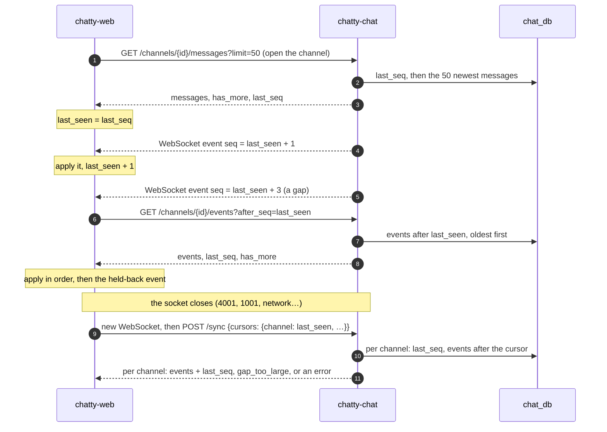

# Flow: open a channel, reconnect and sync

> **In one minute:** Every change in a channel is an event with the channel's next `seq`, stored in
> `channel_events`. The web app keeps, per channel, the last `seq` it has applied. Live events come over
> the WebSocket; if one arrives with a gap in `seq`, or the socket was closed, the web app asks for the
> events it missed: `GET /channels/{id}/events` for one channel, `POST /sync` for all open channels at once.
> If too many are missing, it reloads the channel's history instead.

## The picture

## Step by step

**Open a channel** (`GET /channels/{channel_id}/messages`)

1. The user must be able to read the channel: a member, or anyone in the team for a public channel.
2. In one read transaction chatty-chat reads the channel's `last_seq` **first**, then up to `limit`
   messages (1 to 100, default 50), newest first, with `seq < before_seq` when scrolling up. Reading
   `last_seq` first means a message saved in between comes in this page and again from sync (dropped by
   `seq`), instead of being missed by both.
3. Deleted messages are included, empty, so the order doesn't jump. One extra row tells `has_more`.
4. The web app sets `last_seen = last_seq` for the channel.

**A live event arrives** (the client rules, events.md)

| The event's `seq` | The web app |
|---|---|
| `<= last_seen` | Ignores it: a duplicate |
| `= last_seen + 1` | Applies it, `last_seen = seq` |
| `> last_seen + 1` | A gap: holds it back and fetches the missing ones |

**Fill a gap** (`GET /channels/{channel_id}/events?after_seq=…`)

1. Same read check as history.
2. Up to `limit` events (1 to 500, default 500) with `seq > after_seq`, oldest first, plus `last_seq` and
   `has_more`. With `has_more`, call again with the last `seq` as `after_seq`.
3. If the first event after `after_seq` is gone (cleaned up), `409 gap_too_large`.

**Reconnect** (`POST /sync`)

1. After any close except `4003` (log out), the web app opens a new socket, with backoff. Events that
   arrive meanwhile are held back.
2. It sends `cursors`: channel ID → its `last_seen`, for every channel it has open, at most 500.
3. Each channel is checked on its own. One the user can't read any more answers
   `{"error": "cannot_read_channel"}` or `channel_not_found`; the others still return their events.
4. Per readable channel: if more than 500 events are missing, or the next one was cleaned up,
   `gap_too_large: true` with no events. Otherwise the events after the cursor and `last_seq`.
5. The web app applies each channel's events in order, then the held-back ones; duplicates are dropped by
   `seq`. A channel with `gap_too_large` is reloaded from history; one with an error is dropped.

## If a step fails

| Step | What happens |
|---|---|
| History or events of a channel I can't read | `403 cannot_read_channel` |
| The channel doesn't exist | `404 channel_not_found` |
| `limit` or `after_seq` out of range | `400 validation_error` |
| Events already cleaned up | `GET …/events`: `409 gap_too_large`; `POST /sync`: `gap_too_large: true` |
| `POST /sync` with more than 500 channels or a negative `seq` | `400 validation_error` |
| A channel in `POST /sync` I can't read any more | That channel's `error`; the others are answered |

## ⚠️ Known gaps

- **Events are never cleaned up yet.** `channel_events` is meant to keep 30 days; until the cleanup runs,
  `gap_too_large` only happens when more than 500 events are missing.
- **Sync makes up to two queries per channel** (500 channels max). Batching is the fix if the load test
  shows it ([CHAT-224](https://assist-team-m66z4ph1.atlassian.net/browse/CHAT-224)).
- **No unread counts or `POST /channels/{id}/read` yet.** Only sending moves the sender's read position
  ([CHAT-128](https://assist-team-m66z4ph1.atlassian.net/browse/CHAT-128)).

## Key code

| File | What is there |
|---|---|
| `chatty-chat/app/services/message_service.py` | `list_history`: `last_seq` first, then the page |
| `chatty-chat/app/services/sync_service.py` | `SyncService.sync`, `list_channel_events`, the gap checks |
| `chatty-chat/app/repositories/channel_events.py` | `list_events_after` |
| `chatty-chat/app/repositories/channel_counters.py` | `get_last_seq` |
| `chatty-chat/tests/integration/test_message_history_real.py` | History pages and `last_seq` |
| `chatty-chat/tests/integration/test_sync_real.py` | Sync and channel events against the real database |
