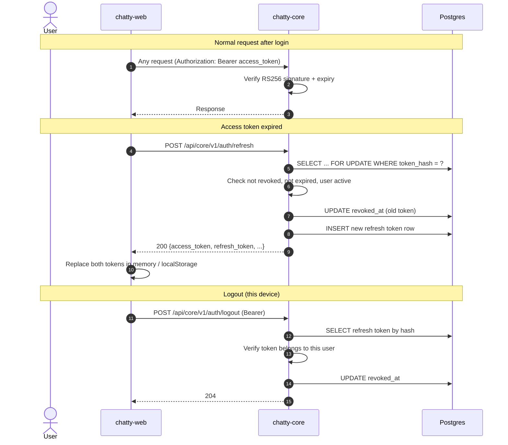

# Flow: refresh and logout

> **In one minute:** The web app keeps the access token in memory and the refresh token in `localStorage`.
> When the access token expires, one call to `/auth/refresh` rotates the pair. Each refresh token works
> exactly once. Logout revokes the token for this device only.

## The picture

## Step by step

### Using the access token

1. The web app attaches `Authorization: Bearer <access_token>` to every request to `/api/core/v1`.
2. chatty-core verifies the RS256 signature and the `exp` claim locally. No database call is needed. If the token is expired or the signature is wrong, `401`.
3. chatty-core loads the user row by `sub` (the user UUID in the token) to check `is_active`. An inactive user gets `403 user_inactive`.

chatty-chat also verifies access tokens — it shares the public key and checks the signature itself. No call to chatty-core is needed there either.

### Refreshing

4. The web app calls `POST /api/core/v1/auth/refresh` with the current refresh token in the request body. This endpoint ignores the `Authorization` header, so the expired access token the web app still attaches does not cause a `401` before the body is read.
5. chatty-core hashes the raw token (SHA-256) and, inside a `SELECT ... FOR UPDATE` transaction, looks up the row.
6. If the row does not exist or has expired, `401 invalid_refresh_token`.
7. **If the token is already revoked, chatty-core treats it as a theft signal.** It revokes _all_ active refresh tokens for that user (every device is logged out) and returns `401`. This is refresh-token reuse detection.
8. If the token is valid, chatty-core revokes the old row and inserts a new refresh token row — both in the same atomic transaction. The user row is not locked (only the token row is, via `select_for_update(of=("self",))`).
9. chatty-core signs a new access token and responds `200` with both new tokens.
10. The web app replaces both tokens. **The old refresh token now returns `401` if presented again.**

### Logout

11. The user clicks "log out". The web app calls `POST /api/core/v1/auth/logout` with the current refresh token. The request must be authenticated (Bearer access token).
12. chatty-core checks the token owner: if the refresh token belongs to a different user, `403 forbidden`. This check happens before the revoked check, so a replayed foreign token does not get a free `204`.
13. If the token is not found or is already revoked, chatty-core does nothing and returns `204` (idempotent).
14. If the token is active, chatty-core sets `revoked_at` and returns `204`.

The access token that was in memory is discarded by the web app. It remains technically valid until it expires (at most 15 minutes), but the web app no longer sends it.

## If a step fails

| Step | What happens |
|---|---|
| 2, access token expired | `401 unauthorized` — the web app should call `/auth/refresh` |
| 2, token signature wrong or malformed | `401 unauthorized` |
| 3, user inactive | `403 user_inactive` |
| 5/6, refresh token not found or expired | `401 invalid_refresh_token` — the user must log in again |
| 7, refresh token already revoked (reuse) | `401 invalid_refresh_token` + all sessions wiped |
| 12, token belongs to another user | `403 forbidden` |

## ⚠️ Known gaps

- **Access tokens cannot be revoked before expiry.** Logout and the reuse wipe both revoke refresh tokens; any access token already issued to that device remains valid for up to 15 minutes.

## Key code

| File | What is there |
|---|---|
| `users/views.py` | `RefreshTokenView`, `LogoutView` |
| `users/serializers.py` | `TokenRequest` |
| `users/services.py` | `UserService.refresh_token`, `UserService.logout` |
| `authn/services.py` | `AuthnService.refresh_tokens` (rotation + reuse detection), `AuthnService.revoke_refresh_token` (owner check) |
| `authn/services.py` | `AuthnService._rotate_sync` (`@transaction.atomic`, `SELECT FOR UPDATE`) |
| `authn/repository.py` | `get_by_hash_sync` (`select_for_update(of=("self",))`), `revoke_sync`, `revoke_all_for_user` |
| `shared/authentication.py` | `JWTAuthentication` (verifies RS256, loads user) |

Next: [Change password](change-password.md).
