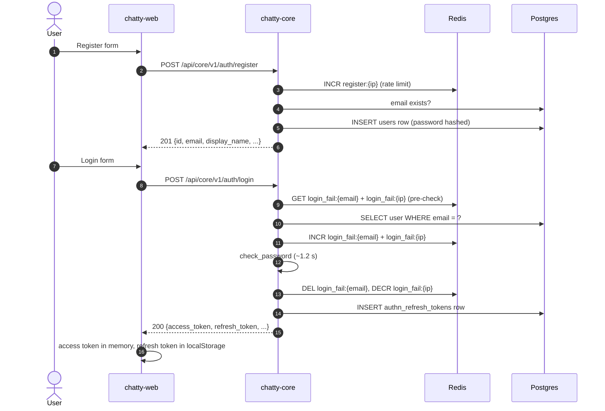

# Flow: register and login

> **In one minute:** A new user registers with email, display name and password. No email verification —
> the account is usable immediately. Login checks the password, enforces rate limits, and returns a
> short-lived access token (15 min) and a long-lived refresh token (30 days).

## The picture

## Step by step

### Register

1. The user fills in email, display name and password. The web app calls `POST /api/core/v1/auth/register`.
2. chatty-core normalizes and lowercases the email so that `ANA@example.com` and `ana@example.com` are the same account.
3. chatty-core checks the rate limit: **10 registrations per hour per IP**. The counter lives in Redis (INCR + EXPIRE NX in one pipeline, so no key is ever stuck without a TTL).
4. chatty-core checks whether the email is already taken. If so, `409 email_taken`.
5. chatty-core hashes the password off the shared sync thread (PBKDF2-SHA256) and inserts the user row. If a race between two requests with the same email slips past step 4, the unique index raises an `IntegrityError`, which also becomes `409`.
6. chatty-core responds `201` with the user object. The account is active immediately — there is no email verification step.

**Password rules:** minimum 10 characters, not entirely numeric, not too similar to the email or display name, not on the common-passwords list.

### Login

7. The user fills in email and password. The web app calls `POST /api/core/v1/auth/login`. Register, login and refresh ignore the `Authorization` header, so a stale access token the web app still sends cannot block them.
8. chatty-core normalizes the email (lowercase), then **pre-checks** the rate limit for both `login_fail:{email}` and `login_fail:{ip}`. The pre-check reads the counter but does not increment it — a currently-blocked email or IP gets `429 too_many_attempts` right away, before any DB work.
9. chatty-core loads the user row by email.
10. chatty-core increments both `login_fail:{email}` and `login_fail:{ip}` **before** checking the password. Parallel guesses would all pass the pre-check at the same time; counting first means a request over the limit (5 / 15 min) gets `429 too_many_attempts` without spending ~1.2 s on a hash.
11. **Timing equalization:** if the email is not found, chatty-core runs a dummy `set_password` call (~1.2 s) to match the cost of a real `check_password`. This prevents the response time from revealing whether an account exists.
12. If the user is inactive, chatty-core still checks the password. Only a **correct** password returns `403 user_inactive`; a wrong one returns `401 invalid_credentials` like any other failure, so nobody can find deactivated accounts without the password.
13. On success chatty-core deletes `login_fail:{email}` and takes back this request's own +1 on `login_fail:{ip}`. The earlier failures from that IP stay counted, so logging into your own account cannot reset the IP limit, and many good logins from one shared IP never lock it. Then it inserts a refresh token row (storing only the SHA-256 hash of the raw token), signs a new access token, and responds `200`.
14. On failure (wrong password or unknown email) both counters keep their +1 and the response is `401 invalid_credentials`.

**Token lifetimes:** access token 15 minutes (`expires_in: 900`), refresh token 30 days (`refresh_expires_in: 2592000`).

## If a step fails

| Step | What happens |
|---|---|
| 3, rate limit exceeded | `429 rate_limited` with `Retry-After` |
| 3, Redis is down | `500` — the pipeline call throws; chatty-core does not bypass the rate limit |
| 4/5, email taken | `409 email_taken` |
| 8, email or IP already blocked | `429 too_many_attempts` with `Retry-After` |
| 10, this request goes over the limit | `429 too_many_attempts` with `Retry-After` (no hash is run) |
| 11/12/14, wrong password or unknown email | `401 invalid_credentials` (same code for both, also for an inactive user) |
| 12, user inactive and password correct | `403 user_inactive` |
| 400 on any step | `400 validation_failed` with per-field reasons (missing field, email format, password too weak) |

## ⚠️ Known gaps

- **No email verification.** The account is active from the moment it is created. A typo in the email address cannot be corrected after registration.
- **No account recovery.** There is no "forgot password" flow yet.

## Key code

| File | What is there |
|---|---|
| `users/views.py` | `RegisterView`, `LoginView` |
| `users/serializers.py` | `RegisterRequest` (password validation, email normalize), `LoginRequest` |
| `users/services.py` | `UserService.register`, `UserService.login` (rate limits, timing fix, token issuance) |
| `users/repositories.py` | `UserRepository.create_user` (hashes password in thread), `get_by_email` |
| `authn/services.py` | `AuthnService.issue_tokens` (creates refresh token row, signs JWT) |
| `shared/redis.py` | `rate_limit` (INCR + EXPIRE NX pipeline), `is_rate_limited` (pre-check), `clear_rate_limit`, `undo_rate_limit` (takes back one hit) |
| `shared/http.py` | `client_ip` (reads `X-Real-IP` behind Nginx) |

Next: [Refresh and logout](refresh-and-logout.md).
