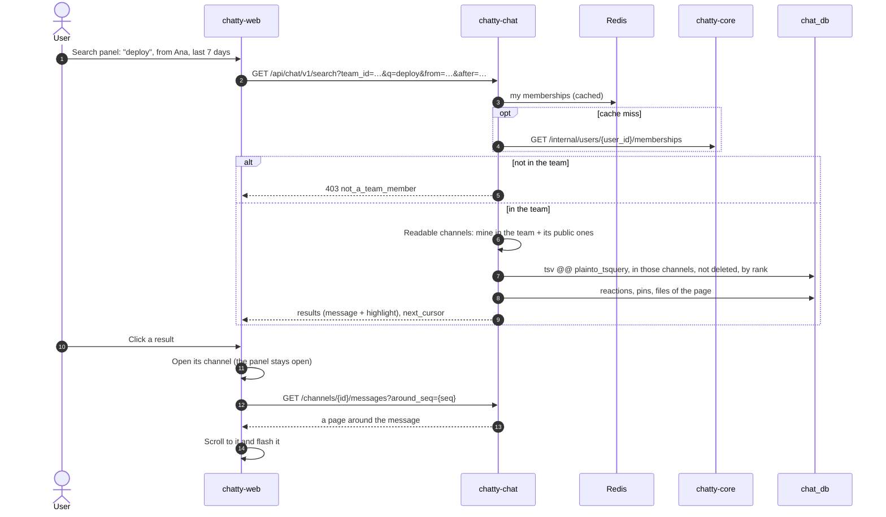

# Flow: search messages

> **In one minute:** Search finds messages by their words in one team. chatty-chat keeps a `tsvector` of each
> message body in Postgres, and `GET /search` matches the query against it, in every channel of the team the
> user can read. Results come best match first, with the found words marked. The web app shows them in a
> panel next to the channel; clicking one opens its channel and jumps to the message with `around_seq`.

## The picture

## Step by step

**What is searched**

1. Every message has a `tsv` column, a stored `tsvector` that Postgres builds from the body with the `english`
   configuration, after removing `<@user_id>` mentions. A GIN index makes the match fast. "deploy" also finds
   "deployed" and "deploys": Postgres matches word stems, not exact text.
2. Deleted messages have an empty body, and are left out anyway.

**The request** (`GET /search`)

1. `team_id` and `q` (2 to 200 characters) are required. Optional: `in` (one channel), `from` (one author),
   `before` and `after` (times with a timezone), `limit` (1 to 50, default 20) and `cursor`.
2. The team must be in the user's memberships (the cache, or chatty-core), else `403 not_a_team_member`.
3. The channels searched are the user's own channels in that team plus the team's public channels, from the
   same memberships. With `in`, only that channel, and only if it is one of those. A channel the user can't
   read gives no results instead of an error, so nobody learns it exists.
4. One query: `tsv @@ plainto_tsquery('english', q)` in those channels, with the filters, ordered by
   `ts_rank` (best match first), then newest, then `id`. `plainto_tsquery` treats `q` as plain words, so
   quotes and operators in it can't break the query.
5. One extra row tells if there is a next page. Then one query each for the page's reactions, pins and files,
   as in history.
6. Each result is the full message object and a `highlight`: `ts_headline` puts markers around the found
   words, then chatty-chat HTML-escapes the text and turns the markers into `<mark>`. Markers that land
   inside a mention's UUID are dropped.

**The cursor.** `next_cursor` holds the last result's rank, time and `id`, and a hash of `team_id`, `q` and
the filters. The next page continues after that row. A cursor sent with other filters, or one that can't be
read, is `400 invalid_cursor`, so pages of two searches can't mix.

**In the web app** (`SearchPanel`, opened with the search button in the channel header, `?search` in the URL)

1. The query needs at least 2 characters. Filters: a channel or DM, a person (the team's active members,
   found by name), and a date: today, 7 days, 30 days or a custom range in local days.
2. Changing a filter searches again right away. A newer search cancels the one still running, so a late
   answer can't replace newer results. "More results" sends the cursor with the same `q` and filters.
3. The highlight is split on `<mark>` into plain text parts, so nothing is ever rendered as HTML, and mentions
   show as `@Name`. My own messages are marked like my bubbles in the chat.
4. Clicking a result opens its channel if it's another one, with the panel still open, and calls `jumpTo`. If
   the message isn't loaded, the channel loads a page around it (`around_seq`), and newer pages follow on
   scroll (`after_seq`). The message scrolls into view and flashes. On a small screen the panel closes.

## If a step fails

| Step | What happens |
|---|---|
| No or bad token | `401 unauthorized` |
| `q` shorter than 2 or longer than 200, a bad `limit`, a time without a timezone | `400 validation_error` |
| Not in the team | `403 not_a_team_member` |
| `in` is a channel I can't read | `200` with no results |
| A cursor from another search, or a broken one | `400 invalid_cursor` |
| chatty-core unreachable and nothing cached | `503 core_unavailable` |
| The web app: the search fails | The panel shows the error; "More results" can be tried again |
| The web app: the message can't be loaded | A toast: "Couldn't load this message. Try again." |

## ⚠️ Known gaps

- **English only.** Stems and stop words are English; other languages match only exact words.
- **Uppercase mention IDs reach the index.** The `tsv` expression removes mentions with a lowercase-only
  pattern, so a `<@…>` written in uppercase is indexed as words.
- **No rate limit**, like the rest of chatty-chat.
- **The person filter can't pick me.** The web app leaves the current user out of the picker.

## Key code

| File | What is there |
|---|---|
| `chatty-chat/app/api/routers/search.py` | `GET /search`: the parameters and their limits |
| `chatty-chat/app/services/search_service.py` | `SearchService.search`, `readable_channel_ids`, the cursor, `to_highlight` |
| `chatty-chat/app/repositories/messages.py` | `search_messages`: the full-text query, rank and `ts_headline` |
| `chatty-chat/app/models/message.py` | The `tsv` column and its GIN index (`SEARCH_CONFIG`) |
| `chatty-web/src/features/search/ui/search-panel.tsx` | The panel: query, filters, results, open a result |
| `chatty-web/src/features/search/utils/highlight.ts` | `parseHighlight`, `showMentions` |
| `chatty-web/src/features/search/utils/date-range.ts` | The date filter as `after` / `before` |
| `chatty-web/src/features/messages/utils/jump-to-message.ts` | Scroll to the message and flash it |
