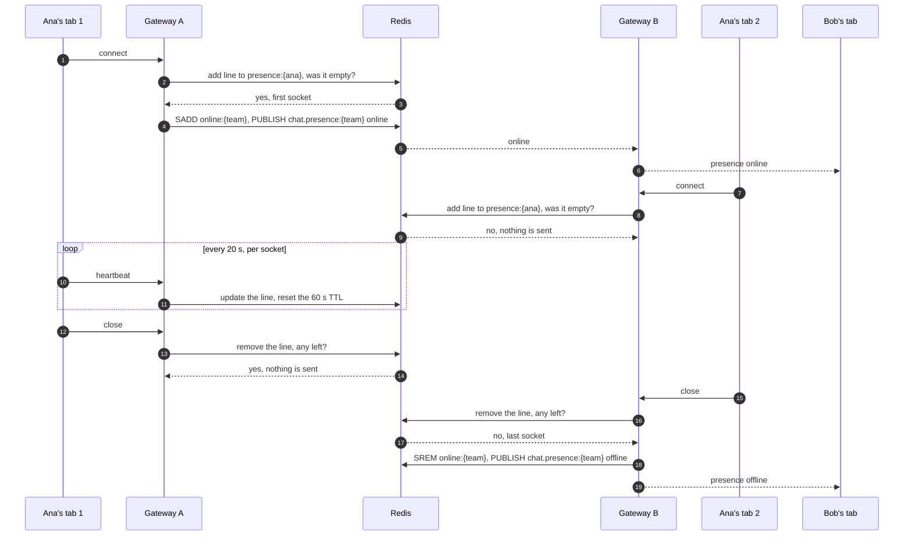

# Flow: see who is online

> **In one minute:** A user is online while they have at least one open WebSocket, and offline when the last
> one closes. It doesn't depend on channels, and they show as online in every team they're in. A process only
> knows its own sockets, so Redis keeps one line per socket and decides who is first and last. A tab that
> opens calls `GET /teams/{team_id}/presence` once, then follows the `presence` messages.

## The picture

Ana has one tab on process A and opens a second one on process B, then closes both:

## Step by step

**Where it lives**

| Name | What it is | Why |
|---|---|---|
| `presence:{user_id}` | Sorted set, one line per open socket: socket ID → time of its last heartbeat. TTL 60 s | Tells which socket is the user's first and last, across processes |
| `online:{team_id}` | Set of user IDs | What the endpoint reads: chatty-chat doesn't have a team's member list |
| `chat.presence:{team_id}` | Pub/sub channel | Sends a `presence` frame to every process with a socket in the team |

**Connect**

1. `gateway.connect` gets the user's teams from their memberships and gives the socket an ID.
2. The socket joins its teams in the registry. A team's first local socket subscribes to its channel.
3. In one Redis transaction: drop lines older than 60 s, count, add this socket's line, set the TTL.
4. If the count was 0 this is the user's first socket: add them to `online:{team_id}` for each team and
   publish `online` to each team.

**Heartbeat**

Every 20 s the socket's line gets the current time and the key's TTL starts again. Nothing is sent. A hidden
tab counts as online: `visible` doesn't change presence.

**Close**

1. `gateway.disconnect` runs in the `finally` of the WebSocket endpoint, so a closed tab, an expired token and
   a lost network (closed with `4002` after 60 s without a heartbeat) all come here.
2. The socket leaves its teams. A team's last local socket unsubscribes from its channel.
3. In one Redis transaction: remove this line, drop lines older than 60 s, count what's left.
4. If nothing is left this was the last socket: remove the user from `online:{team_id}` for each team and
   publish `offline` to each team.

**Why a transaction?** Two sockets of one user can close at the same moment on two processes. Redis runs each
transaction as one step, so exactly one of them sees 0 lines and sends `offline`.

**Sending a frame.** `Gateway.run()` passes `chat.presence:*` messages to `handle_presence`, which sends
`{"type": "presence", "team_id", "user_id", "status"}` to the team's local sockets. A socket closed as
`too_slow` stays in its teams, because `disconnect` needs them to send `offline`, but it gets no more frames:
otherwise each frame would wait 5 s on it.

**Opening a tab** (`GET /teams/{team_id}/presence`)

`presence` messages only report changes, so a new tab doesn't know who is already online.

1. The web app opens the WebSocket first, then calls the endpoint. In the other order, a change between the
   two would be lost.
2. The team must be in the caller's memberships, else `403 not_a_team_member`.
3. chatty-chat reads `online:{team_id}` and leaves out users whose `presence:{user_id}` key is gone. It
   doesn't remove them from the set: that could race with the user reconnecting.
4. The answer is `{"team_id": "t1…", "online": ["u3…", "u7…"]}`. Everyone else in the team is offline.
   Names and avatars come from chatty-core's team members.

**Team changes** (`team.member.changed`, on the gateways with a socket of the user)

| Action | What happens |
|---|---|
| `joined` | The user's sockets join the team, and `online` is sent to it |
| `left`, `removed` | The sockets leave the team, the user is removed from `online:{team_id}`, and `offline` is sent to it. Only the gateway that really removes them sends it |
| `role_changed` | Nothing |

## If a step fails

| Step | What happens |
|---|---|
| Redis is down at connect, heartbeat or close | Logged; the socket stays open. Nobody hears about the change. When Redis is back the gateway closes every socket with `1001`, so they reconnect |
| Redis is down at `GET …/presence` | `200` with an empty `online` list |
| The user isn't in the team | `403 not_a_team_member` |
| `team_id` isn't a UUID | `400 validation_error` |
| A process crashes | `disconnect` never runs, so nobody sends `offline`. The key expires after 60 s, so new tabs see the user as offline |

## ⚠️ Known gaps

- **A crash sends no `offline`.** Tabs that are already open keep showing the user as online until they
  reload the list or the user's next change.
- **A page refresh can flicker** offline and online, also on the early reconnect before a token expires. A
  wait of about 5 s before `offline` would fix it, if it's annoying in practice.
- **A close and a new connect at the same moment can end in the wrong order.** If a last socket closes while
  a new one opens, `offline` can land after `online`, and the user looks offline until they reconnect.
- **The web app shows dots on message avatars and DMs only.** There is no list of who is online.

## Key code

| File | What is there |
|---|---|
| `chatty-chat/app/clients/presence.py` | `PresenceStore`: the Redis keys, transactions and `presence_channel` |
| `chatty-chat/app/services/gateway.py` | `connect`, `heartbeat`, `disconnect`, `handle_presence`, `_team_member_changed` |
| `chatty-chat/app/services/connection_registry.py` | `SocketGroups`: the sockets of each channel and team |
| `chatty-chat/app/services/presence_service.py` | `PresenceService.list_online` |
| `chatty-chat/app/api/routers/presence.py` | `GET /teams/{team_id}/presence` |
| `chatty-chat/tests/integration/test_presence_real.py` | Two gateways, the last two sockets closing at once, stale lines |
