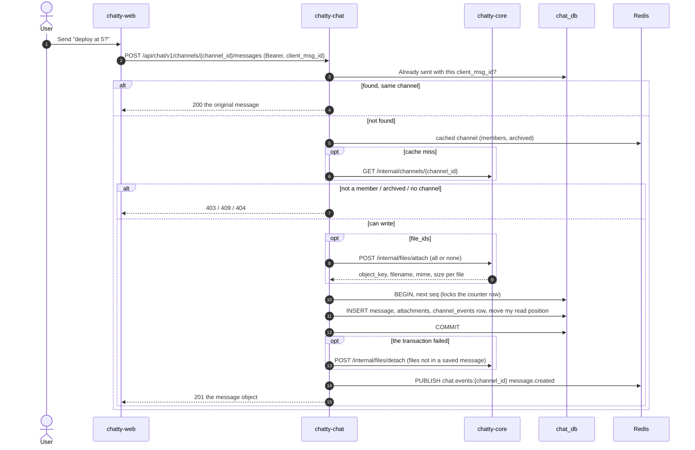

# Flow: send a message

> **In one minute:** The web app sends a message with REST, never over the WebSocket. chatty-chat checks
> that the user can write in the channel and asks chatty-core to attach the message's files, then in one
> transaction takes the channel's next `seq`, saves the message, its attachments and an event row, and moves
> the sender's read position. Only after the commit it publishes
> `message.created`, and every open tab in the channel gets it. The web app makes a `client_msg_id` for
> each message, so a retry after a lost answer returns the same message instead of sending it twice.

## The picture

## Step by step

1. **Validate.** `client_msg_id` is a UUID, `body` is at most 4000 characters, at most 10 `file_ids`. An
   empty body without files is `400 validation_error`. A body of only spaces counts as text.
2. **Retry check, first.** chatty-chat looks up `(author_id, client_msg_id)`. If the message exists in this
   channel, it returns it with `200`: no new `seq`, no event. This runs before the access check, so a retry
   still gets its message after the channel was archived. The same `client_msg_id` in another channel is a
   client bug: `400 validation_error` with `fields.client_msg_id: "already_used"`.
3. **Access.** The channel comes from the cache or chatty-core's `/internal`. The user must be a member,
   and the channel must not be archived or in a deleted team.
4. **Files** (D-03). With `file_ids`, the same file twice is `400 validation_error`. chatty-chat calls
   chatty-core's `POST /internal/files/attach` **before** the transaction, so no transaction is held during
   the call. chatty-core marks all the files attached, or none: each must exist, be mine, be an attachment
   of the channel's team, be `ready` and in no other message ([upload a file](upload-a-file.md)). A refused
   file is `400 invalid_file`. If the refusal is `file_already_attached` and a message with this
   `client_msg_id` was saved meanwhile (a double-click), that message is returned with `200` instead.
   The answer gives each file's `object_key`, `filename`, `mime` and `size`, kept in the order of `file_ids`.
5. **Mentions.** Every `<@user_id>` in the body that is a member of the channel goes into `mentions`, once,
   in order. Mentions of other users stay in the text only.
6. **One transaction:**
   - The next `seq`: `INSERT … ON CONFLICT DO UPDATE SET last_seq = last_seq + 1` on `channel_counters`.
     It locks the counter row until the commit, so the seqs of one channel are handed out one at a time,
     and it also creates the row for a channel's first message.
   - The message row, with that `seq`.
   - One `attachments` row per file, with `position` its place in `file_ids`.
   - A `channel_events` row: `message.created` with the same `seq` and the message object as payload.
   - The sender's read position moves to this `seq` (it only ever moves forward).
7. **If the transaction fails** after files were attached, chatty-chat calls
   `POST /internal/files/detach` for the ones that aren't in a saved message with this `client_msg_id`,
   so they don't stay attached to nothing. If it can't tell whether the save happened, it keeps them: a
   file of a sent message must never be detached.
8. **After the commit**, `message.created` is published on `chat.events:{channel_id}`. Every gateway with
   a socket in the channel forwards it (see [live events](../realtime.md#from-a-saved-change-to-every-tab)).
9. `201` with the message object, `file_ids` and `attachments` (`file_id`, `filename`, `mime`, `size`)
   in the order sent. `object_key` stays in chatty-chat.

**Two sends with the same `client_msg_id` at the same moment** (a double-click). Both can pass step 2
before either saves. The first commits. The second waits for the counter lock, then hits the unique
`(author_id, client_msg_id)`, rolls back (so its `seq` isn't used and there is no gap), detaches the files
it attached that aren't in the first one's message, looks the message up again and returns it with `200`.
Neither gets a `500`.

**Download a message's files** (`GET /messages/{message_id}/attachments`, D-02). Anyone who can read the
channel gets every file of the message in the order sent, each with a download `url` and `expires_at`.
chatty-chat signs the URLs itself, with its own read-only MinIO key, valid 5 minutes, so there is no call
to chatty-core and one call per message. The links say `Content-Disposition: attachment` with the
filename, so the browser saves the file instead of showing it. A deleted message, or one in a channel I
can't read, is `404 message_not_found`.

The web app calls it once for each message with files on screen. Images go straight into `` (a link
still downloads), as one grid that opens a full-screen preview; other files are cards. A URL less than a
minute from expiring is fetched again before a click, and an image that fails to load gets one new URL.

**Why lock the counter row?** Without it, two sends could read the same `last_seq` and both take `seq` 9.
The upsert makes the second wait until the first commits, so 50 sends at once get exactly 1 to 50.

## If a step fails

| Step | What happens |
|---|---|
| No or bad token | `401 unauthorized` |
| The user is deactivated | `403 user_inactive` |
| Body empty without files, over 4000 characters, more than 10 files, a file twice | `400 validation_error` |
| `client_msg_id` already used in another channel | `400 validation_error`, `client_msg_id: already_used` |
| chatty-core refuses a file (not found, not mine, wrong team, not ready, already in a message) | `400 invalid_file`; no file of the message is attached |
| The channel's team was deleted between the access check and attach | `409 channel_archived` |
| Not a member of the channel | `403 not_a_member` |
| The channel doesn't exist | `404 channel_not_found` |
| Archived, or its team was deleted | `409 channel_archived` |
| chatty-core unreachable and nothing cached | `503 core_unavailable` |
| DB error in the transaction | `500`; message, attachments, event row, seq and read position all roll back, and the files are detached |
| chatty-core unreachable during attach | `503 core_unavailable`; nothing is detached, because the files may or may not be attached |
| Redis down when publishing | Logged; still `201`. Other tabs get the message from `POST /sync` ([reconnect and sync](reconnect-and-sync.md)) |

## ⚠️ Known gaps

- **No rate limit on sending.**
- **A detach that keeps failing leaves files attached to no message.** It is tried once after a failed
  send, three times after a delete, then logged.

## Key code

| File | What is there |
|---|---|
| `chatty-chat/app/api/routers/messages.py` | `send_message`: `201`, or `200` for a retry |
| `chatty-chat/app/services/message_service.py` | `MessageService.send`, `_retry`, `extract_mentions`, `_release_unsaved`, `_detach`, `attachment_urls` |
| `chatty-chat/app/clients/core.py` | `CoreClient.attach`, `detach` |
| `chatty-chat/app/clients/storage.py` | `presign_attachment`, `content_disposition` |
| `chatty-chat/app/repositories/channel_counters.py` | `next_seq`: the locking upsert |
| `chatty-chat/app/repositories/messages.py` | `get_by_client_msg_id`, `insert_message` (a duplicate becomes `MessageAlreadySent`) |
| `chatty-chat/app/repositories/read_state.py` | `advance_read_position`: forward only (`GREATEST`) |
| `chatty-chat/tests/integration/test_messages_concurrency.py` | 50 sends at once, and two identical sends at once |
