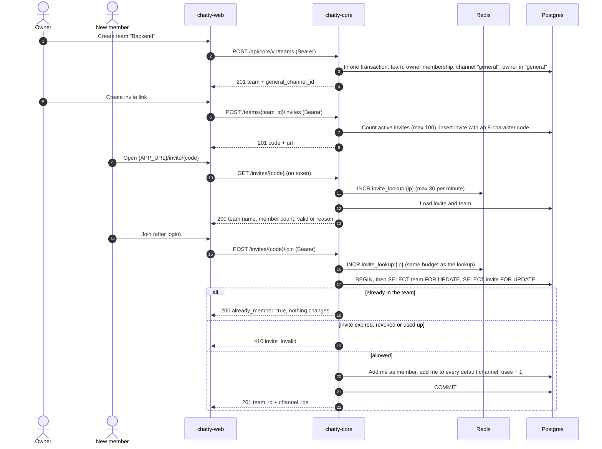

# Flow: teams and invites

> **In one minute:** Anyone logged in can create a team. They become its owner, and chatty-core creates
> a `general` channel at the same time. To bring people in, any member creates an invite link. Opening the
> link needs no login and shows which team it is for. Joining needs a login: the new person becomes a
> `member` and joins every default channel. chatty-core locks the team row while someone joins, so a
> link with 5 uses lets in exactly 5 people, even when many click at once.

## The picture

Creating a team, inviting someone, and them joining:

## Step by step

**Create a team** (`POST /teams`)

1. chatty-core checks that I created fewer than 10 teams that still exist (deleted teams don't count).
2. In one transaction it creates the team, makes me its `owner`, creates the public channel `general`
   marked as default, and makes me owner of `general`.
3. Returns `201` with `general_channel_id`, so the web app can open it straight away.

**Create an invite** (`POST /teams/{team_id}/invites`)

1. Any team member can create one (D-11). `max_age` and `max_uses` must be one of the allowed values;
   `0` means never expires or unlimited.
2. A team has at most 100 active invites.
3. The code is 8 random URL-safe characters. The link is `{APP_URL}/invite/{code}`.

**Open the link** (`GET /invites/{invite_code}`)

1. No token needed: the page is shown before login.
2. Each IP may make 30 lookups or joins per minute, so nobody can guess codes by trying many.
3. Returns the team name, member count and `valid`. If `valid` is `false`, `reason` says `expired`,
   `revoked` or `used_up`.

**Join** (`POST /invites/{invite_code}/join`)

1. Same 30-per-minute budget as the lookup.
2. In one transaction chatty-core locks the team row, then the invite row.
3. If I'm already in the team, it returns `200` and changes nothing; `uses` doesn't go up.
4. Otherwise it checks the invite is still valid, adds me as `member`, adds me to every default channel,
   and adds 1 to `uses`.
5. Returns `201` with the default channels I joined.

**Why lock the team row?** Two people clicking a 1-use link at the same moment would otherwise both see
`uses = 0`, both join, and the link would be used twice. With the lock, the second join waits, then reads
`uses = 1` and gets `410 invite_invalid`.

**Leaving and removal** (`POST /teams/{team_id}/leave`, `DELETE /teams/{team_id}/members/{user_id}`)

1. The last owner can't leave (`409 last_owner`). Admins can't remove owners.
2. The person leaves the team and every channel in it. In a private channel where they were the only
   owner, the member who joined first becomes owner.
3. Every invite they created is revoked, so their links stop letting people in.

**Deleting a team** (`DELETE /teams/{team_id}`, owner only) sets `deleted_at`. The team, its channels
and its invites then return `404`.

## If a step fails

| Step | What happens |
|---|---|
| Create: I already created 10 teams | `409 team_limit_reached` |
| Create invite: I'm not in the team | `403 not_a_team_member` |
| Create invite: 100 active invites already | `409 invite_limit_reached` |
| Lookup or join: no such code, or the team was deleted | `404 invite_not_found` |
| Lookup or join: more than 30 per minute from this IP | `429 rate_limited` |
| Join: expired, revoked or used up | `410 invite_invalid`, `message` says which |
| Redis is down | Lookup and join still work, without the rate limit (fail open) |
| DB error inside the join transaction | `500`, nothing changes: membership, channels and `uses` roll back together |

## ⚠️ Known gaps

- **Open WebSockets aren't updated yet.** Create, join, leave and remove publish `team.member.changed`
  and `membership.changed`, and chatty-chat clears its cache right away. Open WebSockets keep their
  channel list until they reconnect ([CHAT-185](https://assist-team-m66z4ph1.atlassian.net/browse/CHAT-185)).
- **No team icon on the invite page.** `icon_url` is always `null` until file uploads exist.

## Key code

| File | What is there |
|---|---|
| `teams/views.py` | `TeamsView`, `TeamInvitesView`, `InviteLookupView`, `InviteJoinView` |
| `teams/services/teams.py` | `TeamService._create_sync`, `_remove_member_sync` |
| `teams/services/invites.py` | `InviteService.lookup`, `join`, `_join_sync` (the transaction) |
| `teams/repositories/` | `TeamRepository.lock_sync` (the team-row lock), `InviteRepository.lock_by_id_sync` |
| `tests/teams/test_join_race.py` | Two joins on a single-use link at once, run in two threads like two workers |
