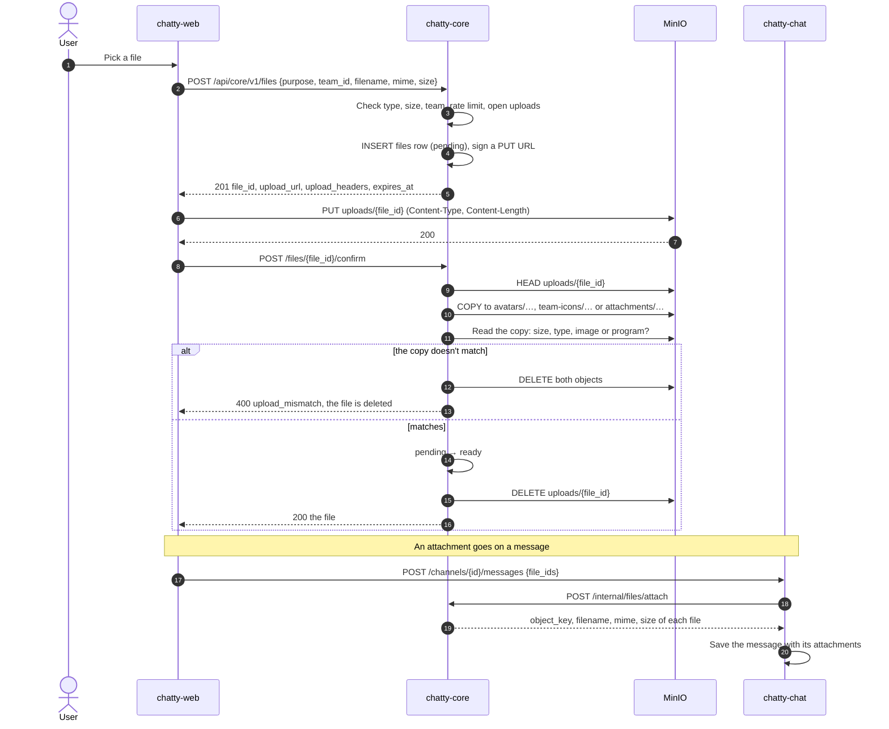

# Flow: upload a file

> **In one minute:** A file never goes through chatty-core or chatty-chat. chatty-core creates a `pending`
> file row and signs a `PUT` URL for `uploads/{file_id}`; the browser uploads straight to MinIO; then
> chatty-core copies the upload to its final key, checks the copy and marks the file `ready`. A ready file
> can become an avatar, a team icon, or go on a message: chatty-chat asks chatty-core to attach it before it
> saves the message. Files nobody uses are cleaned up every hour.

## The picture

## Step by step

**1. Start** (`POST /files`)

1. `purpose` is `avatar` (no `team_id`), `team_icon` or `attachment` (with a `team_id` of a team I'm in).
2. The filename loses path separators, control characters and bidirectional overrides, so
   `invoice‮fdp.exe` can't pose as a PDF.
3. Programs and installers are refused by extension and by declared type for every purpose (D-18).
   Avatars and team icons must be PNG, JPEG, WebP or GIF, at most 2 MB; attachments at most 25 MB.
4. Limits: 30 `POST /files` per user per minute, and at most 20 uploads started and not confirmed yet.
   The open uploads are counted under a lock on my user row, so two at once can't both pass the cap.
5. chatty-core picks the `file_id` first, because the final key contains it, inserts a `pending` row and
   signs a `PUT` URL for `uploads/{file_id}` that accepts only this `Content-Type` and `Content-Length`. It
   is valid 10 minutes.

**2. Upload.** The browser sends the bytes to MinIO with the URL and the headers from the answer. Neither
service sees them.

**3. Confirm** (`POST /files/{file_id}/confirm`)

1. Only the owner can confirm. A file that is already `ready` is returned as it is, so a retry is safe.
2. After the URL expired: `410 upload_expired`. Nothing uploaded: `400 upload_missing`.
3. chatty-core copies `uploads/{file_id}` to the final key inside MinIO and checks **the copy**, not the
   upload, so a second `PUT` to the upload URL can't change what was checked:
   - size and `Content-Type` must be the ones from step 1;
   - an avatar or team icon must really be that image type, and at most 25 megapixels (Pillow reads the
     whole file);
   - an attachment's first 8 KB must not be a Windows, Linux or macOS program (D-18).
4. A copy that fails a check is deleted with its upload, and the file is marked deleted:
   `400 upload_mismatch`.
5. Otherwise `pending` becomes `ready`, only if it is still `pending` and not deleted. If another confirm
   of this file won meanwhile, the answer is what it left. The upload is then deleted.
6. The upload URL still works until it expires, so the client can `PUT` to `uploads/{file_id}` again
   after confirm. That changes nothing: the file is already at its final key, and nothing reads
   `uploads/`. The leftover object goes with the lifecycle rule below.

**4. Use it**

| Purpose | How | Checked |
|---|---|---|
| Avatar | `PUT /me` with `avatar_file_id` | A `ready` avatar I uploaded, under the file's row lock |
| Team icon | `PUT /teams/{team_id}` with `icon_file_id` (owners and admins) | A `ready` team icon of this team, under the file's row lock |
| Attachment | chatty-chat calls `POST /internal/files/attach` before it saves the message (D-03) | Per file: exists, mine, an attachment, of the channel's team, `ready`, not attached yet. All or none |

`GET /files/{file_id}` redirects (`302`) to a presigned `GET` URL for an avatar, or for a team icon of a
team I'm in, valid 5 minutes. Attachments are downloaded through chatty-chat instead
(`400 use_chatty_chat`), see [send a message](send-message.md).

**5. Delete** (`DELETE /files/{file_id}`)

1. Only my own file, and not one that is in a message (`409 file_attached`: delete the message).
2. Under the file's row lock, so it can't overlap with setting it as an avatar or icon: if it is my avatar
   it is cleared; if it is a team's icon I must be an owner or admin, and the icon is cleared.
3. The row gets `deleted_at`, and both objects are deleted right after the commit. If MinIO fails, the
   cleanup removes them later.

**6. Cleanup** (`python manage.py clean_up_files`, hourly, D-17)

1. Files nobody needs are marked deleted, each under its row lock, so a file that is attached or set as
   an avatar at that moment is either skipped or the other request waits and fails:
   - uploads never confirmed, an hour after the URL expired;
   - attachments `ready` for 24 hours and still in no message;
   - avatars and team icons `ready` for 24 hours that no user or team uses;
   - every file of a deleted team.
2. Files marked deleted, up to 500 per run, lose both MinIO objects in one call, then their rows. If
   MinIO fails, the rows stay and the next run tries again.

**The `uploads/` rule** (MinIO, not chatty-core). `setup.bat` gives the bucket a lifecycle rule
(`chatty-infra/minio/lifecycle.json`, D-14): every object in `uploads/` is deleted a day after it was
written. MinIO's background scanner applies it, so it can happen a little later. It is the safety net for
what chatty-core doesn't delete itself: a `PUT` after confirm, or an upload whose delete failed. It can't
hit an upload that is still needed, because confirm refuses anything after the URL's 10 minutes.

**Detach** (`POST /internal/files/detach`): when a message is deleted, or a send fails after attach,
chatty-chat asks chatty-core to mark its files deleted; the cleanup removes them.

**In the web app.** The composer (📎, Ctrl+V or drag and drop) checks the size and type first, then runs
the three steps for each file at once. The `PUT` uses `XMLHttpRequest`, because `fetch` can't report upload
progress. The browser sets `Content-Length` itself, so only `Content-Type` is copied from
`upload_headers`. Send waits until every file is `ready`, then sends their `file_ids` with the message.
Account settings and team settings use the same three steps for the avatar and the team icon, then save it
with `PUT /me` or `PUT /teams/{team_id}`. Avatars and icons are shown from `GET /files/{file_id}`, which
needs the token: the app follows the redirect with `fetch` and shows the image as a `blob:` URL.

## If a step fails

| Step | What happens |
|---|---|
| Start: a program, a wrong image type | `400 type_not_allowed` |
| Start: too big | `400 file_too_large` |
| Start: not in the team | `403 not_a_team_member` |
| Start: over 30 per minute, or 20 open uploads | `429 rate_limited` with `Retry-After` (for the open uploads: when the oldest expires) |
| Confirm: someone else's file | `403 forbidden` |
| Confirm: the URL expired | `410 upload_expired` |
| Confirm: nothing uploaded | `400 upload_missing` |
| Confirm: the bytes don't match | `400 upload_mismatch`; the file is deleted |
| Use: not a ready avatar of mine, or icon of this team | `400 invalid_file` |
| Download: an attachment | `400 use_chatty_chat` |
| Delete: in a message | `409 file_attached` |
| MinIO down | Confirm and delete fail with `500`; signing URLs needs no network, so step 1 still answers |

## ⚠️ Known gaps

- **A file removed from the composer after its upload isn't deleted.** The web app leaves it to
  `clean_up_files`, which removes it after 24 hours.
- **The `uploads/` rule is set up outside the code.** Only `setup.bat` and `reset-db.bat` create it, and
  nothing in chatty-core checks it is there. Another environment without it keeps every object written to
  an upload URL after confirm.
- **An attachment's declared type isn't checked against its bytes**, only that it isn't a program.
  Downloads are always `Content-Disposition: attachment`, so the browser saves it instead of showing it.

## Key code

| File | What is there |
|---|---|
| `chatty-core/files/views.py` | `POST /files`, confirm, download, delete |
| `chatty-core/files/serializers.py` | `CreateFileRequest`, the filename cleanup |
| `chatty-core/files/services.py` | `FileService`: `create_upload`, `confirm`, `download_url`, `delete`, `attach`, `detach`, `clean_up` |
| `chatty-core/files/checks.py` | `detect_image_mime`, `is_program` |
| `chatty-core/files/repositories.py` | The row locks and the one rule for unused files (`_unused_qs`) |
| `chatty-core/shared/storage.py` | Presigned URLs, head, copy, read, delete |
| `chatty-core/files/management/commands/clean_up_files.py` | The hourly job |
| `chatty-web/src/features/files/` | The upload with progress, the checks before it, the composer's uploads, avatar and icon images |
| `chatty-chat/app/clients/core.py` | `CoreClient.attach`, `detach` |
