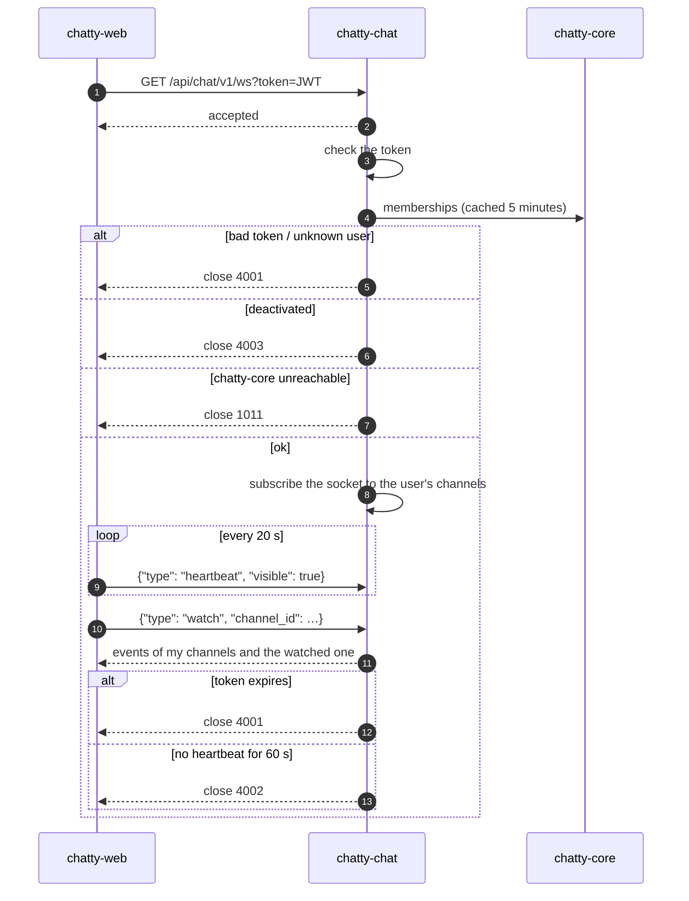

# Flow: connect the WebSocket and keep it open

> **In one minute:** The web app opens one WebSocket per tab with the access token in the URL. chatty-chat
> accepts it, checks the token and the user, and subscribes the socket to every channel the user is in.
> The socket then only receives: events, `channel.updated`, errors. The web app sends a heartbeat every
> 20 s and may watch one public channel. The socket is closed with a code that tells the web app what to
> do next: refresh the token, log out, or just reconnect and sync.

## The picture

## Step by step

1. **Connect.** `GET /api/chat/v1/ws?token=<access token>`: browsers can't set headers on a WebSocket, so
   the token is in the URL. uvicorn's log line hides it (`token=***`).
2. **Accept, then check.** chatty-chat accepts first, so every rejection reaches the browser with our close
   code instead of `1006`. The token must be valid; the user must exist and be active.
3. **Subscribe.** The gateway adds the socket to every channel in the user's memberships. See
   [live events](../realtime.md#connecting-a-socket).
4. **Heartbeat.** Every 20 s the web app sends `{"type": "heartbeat", "visible": …}`. Only a valid
   heartbeat resets the 60 s timer.
5. **Watch.** `{"type": "watch", "channel_id": …}` follows one public channel of the user's teams that they
   haven't joined; a new watch replaces the old one, `unwatch` ends it. Not public in my teams:
   `{"type": "error", "code": "cannot_watch"}`, and the socket stays open.
6. **Anything else** (invalid JSON, unknown types, binary frames) is ignored. A message over 4 KB closes the
   socket with `1009`.
7. **Close and reconnect.** The web app refreshes the token about a minute before `exp` and reconnects
   early. After any close but `4003` it reconnects with backoff and calls `POST /sync`
   ([reconnect and sync](reconnect-and-sync.md)).

## If a step fails

| Close code | Why | The web app |
|---|---|---|
| `4001` | Bad or expired token, unknown user | Refresh the token, reconnect, sync |
| `4002` | No heartbeat for 60 s | Reconnect, sync |
| `4003` | Deactivated (at connect, or `user.deactivated` later) | Log out |
| `1001` | `gateway_restart` after Redis came back, or `too_slow` | Reconnect, sync |
| `1009` | A message over 4 KB | A bug in the web app; reconnect, sync |
| `1011` | chatty-core unreachable at connect, or no pong to uvicorn's ping | Reconnect with backoff, sync |
| `1012` | The process is shutting down | Reconnect with backoff, sync |

## ⚠️ Known gaps

- **No typing or presence yet.** The contract has them; the heartbeat's `visible` is stored but not used
  ([CHAT-215](https://assist-team-m66z4ph1.atlassian.net/browse/CHAT-215)).
- **`4008 too_many_messages` isn't sent yet**: there is no rate limit on client messages.
- **The web client isn't built yet** ([CHAT-126](https://assist-team-m66z4ph1.atlassian.net/browse/CHAT-126)).

## Key code

| File | What is there |
|---|---|
| `chatty-chat/app/api/routers/ws.py` | `websocket_endpoint`, `handle_message`, the deadlines |
| `chatty-chat/app/schemas/ws.py` | `Heartbeat`, `Watch`, `Unwatch`, `ClientMessage` |
| `chatty-chat/app/services/gateway.py` | `connect`, `disconnect`, `watch`, `unwatch` |
| `chatty-chat/app/core/codes.py` | `CloseCode` |
| `chatty-chat/tests/api/test_ws.py` | Close codes, heartbeats and watch |
