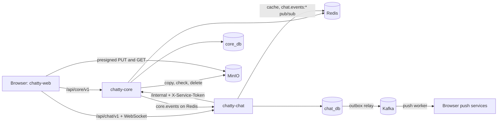

# System overview

The big picture: every service, how they talk, and auth in 30 seconds.

## At a glance

| Service | What it owns | Stack | Status |
|---|---|---|---|
| chatty-web | The app in the browser | React (Vite) | works: login, teams, channels, DMs, invites, messages with files and GIFs, reactions, pins, unread, presence, typing, search, push notifications, avatars and team icons |
| chatty-core | Users, auth, teams, invites, channels, DMs, files | Django | works |
| chatty-chat | Messages and their files, the live WebSocket, sync, reactions, pins, presence, typing, search, push notifications | FastAPI | works |
| chatty-infra | Docker Compose, contracts, setup scripts | | works |

Each backend service has its own Postgres database. They never read each other's database; they talk
only through the contracts in [chatty-infra/docs](https://github.com/Chatty4/chatty-infra/tree/dev/docs).

## The diagram

The browser uploads and downloads files straight from MinIO with links the services sign; chatty-chat
signs attachment links with its own read-only key and never calls MinIO.

## How the services talk

| From → to | How | What for | Status |
|---|---|---|---|
| web → core | HTTPS JSON, `/api/core/v1` | Accounts, teams, channels, starting and confirming uploads | works |
| web → chat | HTTPS JSON and a WebSocket, `/api/chat/v1` | Messages, history, sync, search, push subscriptions, live events | works |
| web → MinIO | Presigned `PUT` and `GET` URLs (D-15, D-16) | Uploads, avatars, team icons, attachment downloads | works ([upload a file](flows/upload-a-file.md)) |
| web → GIPHY | HTTPS, `api.giphy.com` and its media hosts | The GIF picker's search, and showing GIFs | works; the key is in the browser ([chatty-web](../services/web/index.md)) |
| chat → core | HTTP, `/internal`, `X-Service-Token` | Who is in which channel (D-07), file attach and detach (D-03) | works |
| core → chat | Redis pub/sub `core.events` | "Something changed": clear the cache, update open WebSockets (D-06, D-08) | works ([core events](flows/core-events.md)) |
| chat → chat | Redis pub/sub `chat.events:{channel_id}` | A saved change reaches the gateways with sockets in the channel | works ([live events](realtime.md)) |
| chat → Kafka → push worker | The outbox relay sends `channel_events` to the topic `chat.events` | New messages become Web Push for browsers with no tab on screen | works ([get a push notification](flows/get-a-push-notification.md)) |

In production every browser request goes through chatty-web's Nginx (D-09). Locally the Vite dev server
forwards the same paths to the services on `127.0.0.1`, so the browser only talks to its own origin.

## Auth in 30 seconds

1. The user logs in to chatty-core and gets two tokens: an **access token** (15 minutes) and a
   **refresh token** (one per device).
2. Every request sends the access token as `Authorization: Bearer`. chatty-core signs it with its private
   RSA key; chatty-core and chatty-chat check it with the public key, so neither looks anything up.
3. When the access token runs out, the web app swaps the refresh token for a new pair. The old refresh
   token stops working.
4. chatty-chat calls chatty-core with a shared secret, the service token, never with a user's token.

Full details: [auth and security](auth-and-security.md).
