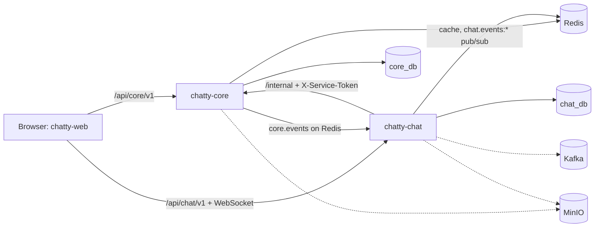

# System overview

The big picture: every service, how they talk, and auth in 30 seconds.

## At a glance

| Service | What it owns | Stack | Status |
|---|---|---|---|
| chatty-web | The app in the browser | React (Vite) | routes and placeholder pages; no screens built yet |
| chatty-core | Users, auth, teams, invites, channels, DMs, files | Django | works, except files |
| chatty-chat | Messages, the live WebSocket, sync, reactions, search | FastAPI | messages, history, sync and the WebSocket gateway work; reactions, pins, files and search not yet |
| chatty-infra | Docker Compose, contracts, setup scripts | | works |

Each backend service has its own Postgres database. They never read each other's database; they talk
only through the contracts in [chatty-infra/docs](https://github.com/Chatty4/chatty-infra/tree/dev/docs).

## The diagram

Solid lines work today; dashed lines are planned.

## How the services talk

| From → to | How | What for | Status |
|---|---|---|---|
| web → core | HTTPS JSON, `/api/core/v1` | Accounts, teams, channels | works |
| web → chat | HTTPS JSON and a WebSocket, `/api/chat/v1` | Messages, history, sync, live events | works; the web client is **planned** ([CHAT-126](https://assist-team-m66z4ph1.atlassian.net/browse/CHAT-126)) |
| chat → core | HTTP, `/internal`, `X-Service-Token` | Who is in which channel (D-07), file attach (D-03) | memberships and channel work; file attach **planned** ([CHAT-212](https://assist-team-m66z4ph1.atlassian.net/browse/CHAT-212)) |
| core → chat | Redis pub/sub `core.events` | "Something changed": clear the cache, update open WebSockets (D-06, D-08) | works ([core events](flows/core-events.md)) |
| chat → chat | Redis pub/sub `chat.events:{channel_id}` | A saved change reaches the gateways with sockets in the channel | works ([live events](realtime.md)); Kafka **planned** |

In production every browser request goes through chatty-web's Nginx (D-09). Locally the services are
reached directly on `127.0.0.1`.

## Auth in 30 seconds

1. The user logs in to chatty-core and gets two tokens: an **access token** (15 minutes) and a
   **refresh token** (one per device).
2. Every request sends the access token as `Authorization: Bearer`. chatty-core signs it with its private
   RSA key; chatty-core and chatty-chat check it with the public key, so neither looks anything up.
3. When the access token runs out, the web app swaps the refresh token for a new pair. The old refresh
   token stops working.
4. chatty-chat calls chatty-core with a shared secret, the service token, never with a user's token.

Full details: [auth and security](auth-and-security.md).
