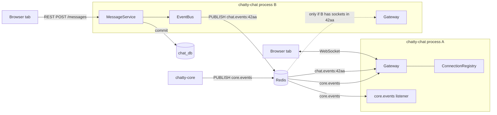
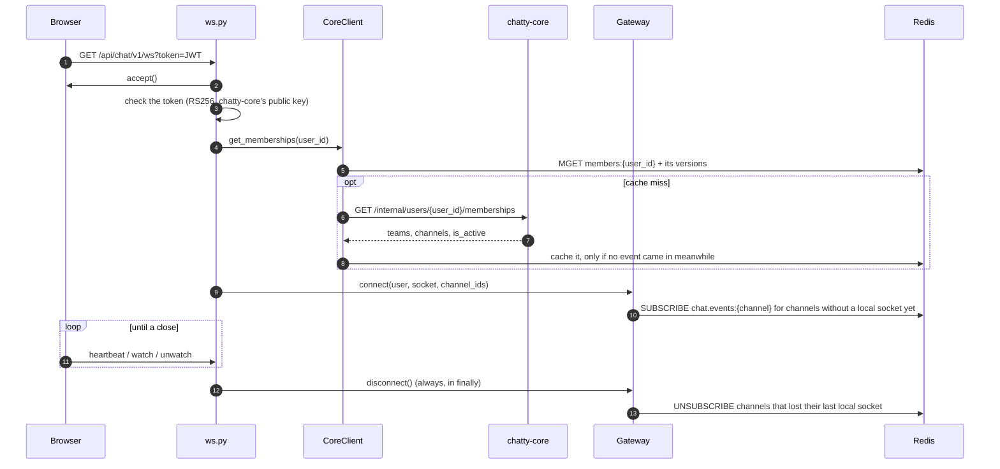
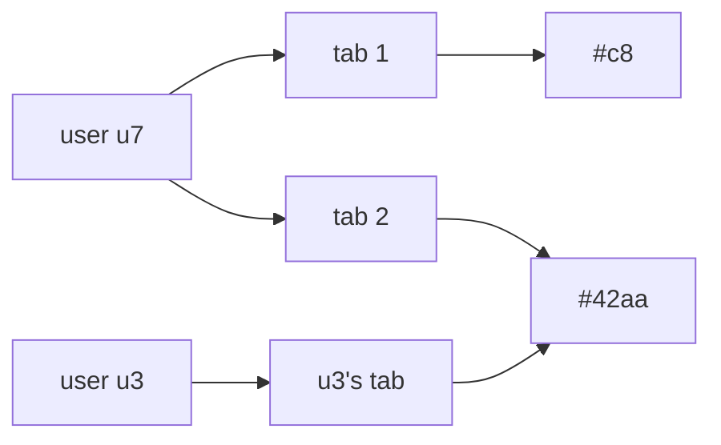
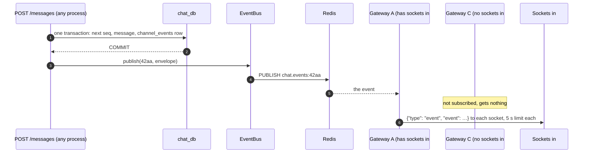
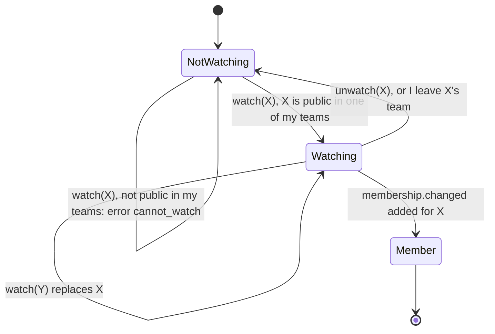
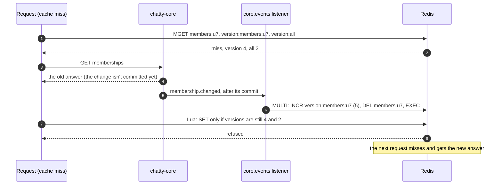

# Live events: sockets, Redis, gateways and the cache

How a change reaches every open browser tab, and how chatty-chat keeps chatty-core's answers in a
cache without serving stale access.

> **In one minute:** A browser keeps one WebSocket open to chatty-chat. Writes never go over it: they
> go through REST, and after the change is saved chatty-chat **publishes** an event on Redis pub/sub.
> Every chatty-chat process runs one **gateway**: a single Redis subscription that receives events and
> forwards them to the sockets connected to that process. A gateway only subscribes to the channels its
> own sockets are in. chatty-core publishes its own events (`core.events`) the same way, and chatty-chat
> uses them to update open sockets and to delete stale cache keys. Pub/sub keeps nothing: a missed event
> is recovered from the database with `POST /sync`.

## The pieces

| Piece | What it is | Code (chatty-chat) |
|---|---|---|
| WebSocket | One long-lived connection per browser tab, so the server can send at any time | `app/api/routers/ws.py` |
| Process | One running uvicorn with the FastAPI app. There can be several; each is a gateway for its own sockets | `app/main.py` |
| Gateway | One per process. Owns one Redis pub/sub connection, receives events, sends them to local sockets | `app/services/gateway.py` |
| ConnectionRegistry | In memory, per process: which sockets each user has, and which sockets are in each channel | `app/services/connection_registry.py` |
| EventBus | The sending side: one `PUBLISH` on `chat.events:{channel_id}` per channel event | `app/services/event_bus.py` |
| Redis cache | chatty-core's `/internal` answers, kept 5 minutes, with version counters | `app/clients/core.py` |
| `core.events` listener | Deletes the cache keys a chatty-core event makes stale | `app/clients/core_events.py` |
| `channel_events` table | Every channel event with its `seq`, the source of truth for catching up | `app/models/channel_event.py` |

The process that saves a message is usually not the one holding the receivers' sockets. Redis
pub/sub connects them: every process publishes to Redis and listens to Redis, so it doesn't matter which
process a browser is connected to.

## Redis: two jobs

Redis does two unrelated things for chatty-chat.

| Job | How it works | Keys or channels |
|---|---|---|
| **Cache** | Plain keys with a TTL. A read that finds the key is a **hit**; a read that doesn't is a **miss**, and chatty-chat asks chatty-core and stores the answer | `members:{user_id}`, `channel:{channel_id}`, and the counters `version:members:{user_id}`, `version:channel:{channel_id}`, `version:all` |
| **Pub/sub** | Named channels. A `PUBLISH` reaches every connection that is `SUBSCRIBE`d to that name **right now**. Nothing is stored: a subscriber that isn't listening misses the message | `chat.events:{channel_id}` (one per chat channel), `core.events` (chatty-core's) |

chatty-chat uses two Redis clients (`app/main.py`):

- `app.state.redis`: cache reads and writes, and `EventBus.publish`. 2 s socket timeouts.
- `events_redis`: the listeners. Retries are off, so a dropped connection surfaces at once and the code's
  own reconnect loops take over. Each `pubsub()` opens its own connection: a connection in subscribe mode
  can't run `GET` or `PUBLISH`. `pubsub.listen()` waits with no timeout, but redis-py 8.1 turns on TCP
  keepalive by default, so a connection that dies silently fails after about 45 s and the loops reconnect.

## Start-up

The app's lifespan creates the registry and the gateway and starts two background tasks:

| Task | Subscribes to | Job |
|---|---|---|
| `gateway.run()` | `core.events`, and `chat.events:{channel_id}` for every channel a local socket is in | Keep open sockets right |
| `listen_core_events()` | `core.events` | Keep the cache right |

Both tasks get every `core.events` message, because pub/sub gives each subscriber its own copy. A crash
in either task is logged (`log_crash`), and `/health` then answers `503` with `"tasks": "error"`, because
that process no longer keeps its sockets or its cache right (CHAT-269). On shutdown both are cancelled, and uvicorn closes the open sockets
with `1012`.

## Connecting a socket

1. chatty-chat **accepts first**, then checks. A socket closed before `accept()` reaches the browser as
   `1006` with no reason; after it, the browser gets our close code.
2. The token comes in the URL (browsers can't set headers on a WebSocket). Bad or expired: `4001`.
   uvicorn logs the URL, so `setup_logging` replaces `token=…` with `token=***` in its log lines.
3. The user's memberships come from the cache or chatty-core. Unknown user: `4001`. Deactivated: `4003`.
   chatty-core unreachable: `1011 core_unavailable`.
4. `gateway.connect` adds the socket to the registry under the user and under each of their channels.
5. The socket then waits for client messages until a deadline passes or it closes.

## The ConnectionRegistry

Three maps, in memory, for this process only:

| Map | Answers | Used for |
|---|---|---|
| user → sockets | Which sockets does this user have? | `user.deactivated`, `membership.changed` |
| channel → sockets | Who gets an event for this channel? | Every channel event |
| socket → channels | Which channels is this socket in? | A quick `leave_all` on disconnect |

`join()` returns `True` when a channel gets its **first** local socket, and `leave()` / `leave_all()`
report when one loses its **last**. That is the signal to `SUBSCRIBE` or `UNSUBSCRIBE` in Redis. So a
process subscribes to each channel once, whether 1 or 500 of its sockets are in it, and only to channels
its own users need.

## From a saved change to every tab

1. The event is published **only after the commit**, so nobody hears about a change that rolled back.
2. Every process with a socket in the channel is subscribed to `chat.events:{channel_id}` and gets the
   event. The gateway looks up the channel's local sockets and sends them all at once.
3. A socket that doesn't take the frame within 5 s is removed from its channels and closed with
   `1001 too_slow` in the background, so its browser reconnects and syncs. The socket's own handler then
   sees it is already closed and doesn't close it a second time.
4. The sender's own tab gets the message twice, in the REST answer and as an event. The web app keeps one,
   by `id`.

**The live path may lose an event, and that is fine.** `EventBus.publish` logs a Redis error and the REST
call still succeeds. The event is in `channel_events` with its `seq`, so a client that sees a gap or
reconnects gets it from [`POST /sync`](flows/reconnect-and-sync.md).

## chatty-core's events on open sockets

The gateway's own `core.events` subscription keeps sockets that are already open right:

| Event | What the gateway does |
|---|---|
| `membership.changed` `added` | The user's sockets join the channel (`SUBSCRIBE` if first). A watch on that channel becomes a membership |
| `membership.changed` `removed` | The user's sockets leave the channel (`UNSUBSCRIBE` if last). Its events stop right away |
| `channel.updated` | Sends `{"type": "channel.updated", …}` to the channel's sockets, so the sidebar refreshes |
| `user.deactivated` | Closes the user's sockets with `4003` |
| `team.member.changed` `left` or `removed` | Ends a watch on that team's channel. The channel memberships come as their own `membership.changed removed` |
| `team.deleted` | Nothing: the team's channels reject writes, so no new events arrive |

The gateway handles `core.events` and the `chat.events:*` channels on **one** connection, one message at a
time, so a `membership.changed removed` that arrived first is applied before the next channel event is
forwarded. Every process gets the same event and updates its own sockets.

## Watching a public channel

A socket can follow one public channel the user hasn't joined, for example while they look at it.

- At most one watched channel per socket. If the user is already a member, nothing changes, so a later
  `unwatch` can't remove a membership.
- A watch uses the same `join()` / `SUBSCRIBE` as a membership.

## Keeping the socket alive

| Mechanism | Who | Catches |
|---|---|---|
| Ping/pong | uvicorn pings every 20 s; the browser answers on its own. No pong within 20 s closes the socket (`1011`) | A dead connection: a sleeping laptop, a dropped network |
| Heartbeat | The web app sends `{"type": "heartbeat", "visible": …}` every 20 s. None for 60 s closes with `4002` | A frozen app; `visible` says if the tab is on screen |
| Token deadline | The same timer watches the token's `exp` and closes with `4001` | An expired token; the web app should refresh and reconnect about a minute earlier |

Only a valid heartbeat resets the 60 s timer. Invalid JSON, unknown types and binary frames are ignored.
A message over 4 KB is closed with `1009` by uvicorn (`--ws-max-size 4096`).

## Close codes

| Code | Reason | Sent by |
|---|---|---|
| `4001` | `token_expired`: bad or expired token, unknown user | `ws.py` |
| `4002` | `heartbeat_timeout` | `ws.py` |
| `4003` | `user_inactive` | `ws.py`, gateway on `user.deactivated` |
| `1001` | `gateway_restart` (Redis came back) or `too_slow` | gateway |
| `1009` | a message over 4 KB | uvicorn |
| `1011` | `core_unavailable` at connect, or no pong | `ws.py`, uvicorn |
| `1012` | shutdown | uvicorn |

After any close but `4003`, the web app reconnects with backoff and calls `POST /sync`
([reconnect and sync](flows/reconnect-and-sync.md)). The full table is in
[events.md](https://github.com/Chatty4/chatty-infra/blob/dev/docs/events.md#ws-close).

## The cache and its versions

`CoreClient` keeps chatty-core's `/internal` answers so not every request calls chatty-core:

1. **Read:** one `MGET` gets the key and its two version counters (the key's own and `version:all`).
2. **Hit:** use the cached body.
3. **Miss:** ask chatty-core (2 s timeout), then store the answer with a Lua script that writes it **only
   if neither counter changed** since step 1.
4. **An event** (`core_events.py`) increments the key's counter, then deletes the key, in one
   transaction. `team.deleted` and the full clear after a reconnect increment `version:all`.

**Why the versions:** without them, a request that got its answer just before the change could write it
back just after the event deleted the key, and the removed user would keep access until the TTL ends
(5 minutes). Increment first, then delete: an old answer written before is deleted, one written after is
refused. A script runs as one step in Redis, so nothing can come in between the check and the write.

- If Redis is down, the cache is skipped: every request asks chatty-core and nothing is cached.
- On every (re)subscribe, the listener bumps `version:all` and deletes all `members:*` and `channel:*`
  keys, because events sent while it wasn't listening are lost (D-08). It scans and deletes in batches of
  500, never `KEYS`.
- The counters expire after a day. A request lasts about 2 s, so none can see its counter expire mid-way.

## If something is down

| Down | What happens |
|---|---|
| Redis, while publishing | `EventBus.publish` logs it; the REST call succeeds; clients get the event from `POST /sync` |
| Redis, while listening | The gateway retries (1 s, doubling up to 30 s). When it is back it closes every local socket with `1001 gateway_restart`, because pub/sub doesn't replay what was missed, and subscribes again |
| Redis, for the cache | Every access check asks chatty-core; nothing is cached |
| A socket stops reading | 5 s send limit, then it leaves its channels and is closed with `1001 too_slow` |
| chatty-core, at connect | `1011 core_unavailable` |
| chatty-core, later | Access checks that aren't cached fail with `503 core_unavailable` |
| The process shuts down | uvicorn closes its sockets with `1012`; the browsers reconnect to another process |

## ⚠️ Known gaps

- **Watch uses the memberships loaded at connect.** Someone removed from a team can start a new watch on
  its public channels until they reconnect ([CHAT-231](https://assist-team-m66z4ph1.atlassian.net/browse/CHAT-231)).
- **One stuck socket delays its gateway's events** by up to 5 s once, before it is dropped. A queue per
  socket is the fix if the load test shows it ([CHAT-224](https://assist-team-m66z4ph1.atlassian.net/browse/CHAT-224)).
- **No typing, presence or unread messages yet** on the socket. The heartbeat's `visible` is stored but not
  used yet ([CHAT-215](https://assist-team-m66z4ph1.atlassian.net/browse/CHAT-215)).
- **Kafka isn't used yet.** Events go over Redis pub/sub; the outbox (`channel_events.published_at`) has no
  relay yet. See the [data map](data-map.md#kafka).

Full list: [known limitations](known-limitations.md).

## Key code

| File | What is there |
|---|---|
| `chatty-chat/app/main.py` | The lifespan: both Redis clients, the gateway and the `core.events` listener |
| `chatty-chat/app/api/routers/ws.py` | Accept, token and memberships check, client messages, deadlines, close codes |
| `chatty-chat/app/services/gateway.py` | `Gateway`: `connect`, `disconnect`, `watch`, `run`, channel and core events, the 5 s send limit |
| `chatty-chat/app/services/connection_registry.py` | `ConnectionRegistry`: the three maps, first and last socket |
| `chatty-chat/app/services/event_bus.py` | `EventBus.publish`, `channel_name` |
| `chatty-chat/app/clients/core.py` | `CoreClient`: the cache, `MGET` and the Lua write |
| `chatty-chat/app/clients/core_events.py` | `mark_stale`, `mark_all_stale`, `clear_cache`, the listener loop |
| `chatty-chat/app/core/logging.py` | `RedactTokens`: hides `token=…` in uvicorn's log lines |
| `chatty-chat/tests/integration/test_two_gateways_real.py` | One event reaching sockets on two gateways |
